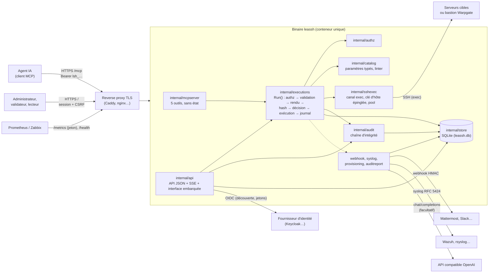

**Français** · [English](en/architecture.md)

# Architecture de Leassh

Ce fichier est la référence versionnée avec le code (constitution, principe 11) ; il est mis à jour dans la même merge request que le code qu'il décrit.

## Composants

Un seul processus, un seul conteneur ([ADR 0002](adr/0002-binaire-unique-front-et-back.md)) : le frontend React est embarqué dans le binaire. Stack : Go et SQLite ([ADR 0003](adr/0003-choix-de-la-stack-go-sqlite.md)).

## Flux principal : `run_command`

1. L'agent appelle `run_command(server, command, params, reason)` sur `/mcp` avec sa clé.
2. `executions.Run()` — **unique chemin d'exécution** — vérifie les droits (`authz`), valide chaque paramètre selon son type, rend le template avec échappement POSIX, vérifie le hash du template, décide : exécuter, mettre en attente de validation humaine, ou refuser.
3. Dans tous les cas, une ligne `executions` est écrite (refus compris), chaînée par hash.
4. Si la validation est requise, un humain approuve ou refuse dans l'interface (écran Validations) ; une décision est atomique avec son événement d'audit.
5. L'exécution ouvre un canal SSH `exec` (jamais de shell ni de PTY) après vérification stricte de la clé d'hôte, capture une sortie tronquée, écrit le résultat.
6. Les observateurs (webhook, syslog) sont notifiés ; ils ne peuvent rien exécuter.

## Frontières de confiance

| Frontière | Qui franchit | Contrôle |
|---|---|---|
| Internet / réseau → reverse proxy | Tout le monde | TLS, en-têtes `X-Forwarded-*` crus seulement des proxies de confiance déclarés |
| Proxy → `/mcp` | Agents IA (non fiables) | Clé MCP (hash en base, comparaison à temps constant), limite de 60 appels d'outils/min, catalogue fermé, validation humaine des écritures |
| Proxy → API/interface | Humains authentifiés | Session cookie `HttpOnly` + CSRF, rôles `admin`/`approver`/`viewer`, SSO OIDC, limiteur d'échecs persistant |
| Leassh → serveurs cibles | Commandes validées | Canal `exec` seul, clé d'hôte épinglée, utilisateur SSH dédié recommandé |
| Leassh → URL sortantes (webhook, IA, OIDC, bastion) | Configurées par un admin | `http(s)` seulement, redirections non suivies (webhook, IA), corps distants non relayés ([note](securite-sorties-et-urls.md)) |
| Disque | Quiconque lit la base | Secrets chiffrés AES-256-GCM avec `LEASSH_MASTER_KEY` (hors base) ; mots de passe en argon2id ; jetons MCP en hash |

Une **sortie de commande** est une donnée non fiable renvoyée à l'agent (injection de prompt possible) : l'effet reste borné par le catalogue, les droits de la clé et la validation humaine.

## Données stockées et conservation

| Donnée | Table(s) | Sensible | Conservation |
|---|---|---|---|
| Comptes (identifiant, nom affiché, rôle, hash argon2id, lien SSO `(issuer, sub)`) | `users` | Personnelle | Jusqu'à suppression du compte par un admin |
| Sessions | `sessions` | Oui | Durée de session réglable (12 h par défaut), 30 min d'inactivité ; une session expirée est refusée, sa ligne est supprimée à la déconnexion ou à la suppression du compte (pas de purge périodique des sessions abandonnées) |
| Échecs de connexion (IP, compte) | `login_failures` | Personnelle (IP) | Fenêtre de 15 min ; les lignes périmées sont supprimées par le limiteur |
| Identités SSH (clé privée chiffrée) | `identities` | **Secret** | Jusqu'à suppression |
| Serveurs, groupes, empreintes de clé d'hôte | `servers`, `server_groups`… | Non | Jusqu'à suppression |
| Catalogue (commandes, groupes, propositions) | `commands`, `proposals`… | Non | Jusqu'à suppression |
| Clés MCP (hash, préfixe, expiration) | `mcp_keys` | Oui (hash) | Jusqu'à suppression ; le jeton n'est jamais conservé en clair |
| Exécutions (agent, serveur, commande rendue, paramètres, motif, décideur, sortie) | `executions` | Personnelle (décideur), parfois sensible (sortie) | **Rétention réglable, 365 jours par défaut, 0 = illimitée** ; purge quotidienne (événement `logs.purge`) |
| Journal d'administration (acteur, action, diff sans secret, IP) | `audit_events` | Personnelle | Même rétention que ci-dessus |
| Rapports d'audit (instantané, synthèse IA) | `audit_reports` | Agrégats | Non supprimables depuis l'interface |
| Livraisons de webhook | `webhook_deliveries` | Non | 200 dernières consultables |
| Réglages (SSO, syslog, webhook, IA, général) | `oidc_config`, `syslog_config`, `app_settings`… | Secrets chiffrés | Jusqu'à modification |
| Logs applicatifs (JSON, sortie standard) | — | Sans secret ni contenu d'arguments MCP | Selon votre collecteur de logs |

### Données personnelles (niveau N3)

- **Nature** : identifiants et noms affichés des utilisateurs, adresses IP des clients, identité de l'agent et de la personne qui valide. Aucune donnée sensible au sens du RGPD n'est collectée par Leassh lui-même ; les **sorties de commandes** peuvent en contenir selon les commandes du catalogue.
- **Finalité et base légale** : sécurité des systèmes et traçabilité des accès (intérêt légitime de l'organisation) ; à confirmer par le responsable de traitement de l'organisation qui déploie Leassh.
- **Minimisation** : la synthèse IA ne reçoit que des agrégats ; syslog et webhook n'envoient jamais la sortie des commandes ; le CSV d'export n'inclut pas les sorties.
- **Effacement** : la suppression d'un compte est possible ; le journal conserve le nom de l'acteur jusqu'à la fin de la rétention, car la chaîne d'intégrité interdit de réécrire une ligne ([ADR 0004](adr/0004-chaine-integrite-du-journal.md)). Pour effacer plus tôt, réduisez la rétention. Cette limite doit figurer dans la politique de conservation de l'organisation.

## Observabilité

`/health` (sonde), `/metrics` (Prometheus, fermé tant qu'aucun jeton n'est défini), dont la durée des appels sortants (`leassh_outbound_duration_seconds{target,result}`). Logs JSON sur la sortie standard.
