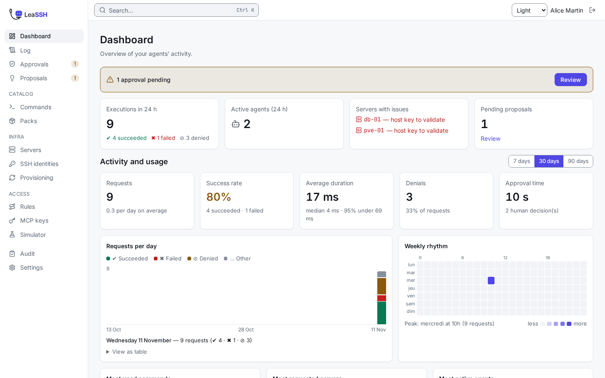

**English** · [Français](../fr/README.md)

# Leassh documentation

> **Give your AI agents SSH access… on a leash.** A catalogue of validated commands, clear permissions, and a log of everything that was run, by whom and where.

Leassh is an open source **MCP** server that gives AI agents SSH access **limited to a catalogue of validated commands**: no shell, typed parameters, human approval of sensitive actions and a complete log.

## Where to start

| I want to… | Page |
|---|---|
| Understand what Leassh is for | [Overview and concepts](overview.md) |
| Install it (Docker, binary, reverse proxy) | [Installation](installation.md) |
| Go from installation to the first execution | [Getting started](getting-started.md) |
| Use the interface screen by screen | [User manual](user-manual.md) |
| Connect an AI agent | [MCP agents and tools](mcp-agents.md) |
| Understand the security model | [Security](security.md) |
| Plug in my SSO (Keycloak…) | [SSO](sso.md) |
| Back up, update, monitor | [Operations](operations.md) |
| Call the API | [API reference](api-reference.md) |
| Solve a problem | [Troubleshooting and FAQ](troubleshooting.md) |
| Contribute code | [Contributing](contributing.md) |

## At a glance

## Suggested path

1. Read the [overview](overview.md) (10 minutes).
2. Follow the [installation](installation.md) then [getting started](getting-started.md).
3. Browse the [manual](user-manual.md) as needed.
4. Before going to production: [security](security.md) and [operations](operations.md).

Source code and tickets: [GitHub repository](https://github.com/sebdew/LeaSSH). Apache 2.0 license.

> The interface is available in French and English; some generated content (audit report facts, agent-provided reasons, the normative `docs/specs/SPEC.md`) stays in French.

## All pages

**Documentation**

**English** · [Français](../fr/README.md)

- [Home](README.md)

**Get started**

- [Overview and concepts](overview.md)
- [Installation](installation.md)
- [Getting started](getting-started.md)

**User manual**

- [User manual](user-manual.md)
  - [Sign-in and setup](sign-in.md)
  - [Dashboard](dashboard.md)
  - [Log](log.md)
  - [Approvals](approvals.md)
  - [Proposals](proposals.md)
  - [Servers and server groups](servers.md)
  - [SSH identities](ssh-identities.md)
  - [Provisioning (Warpgate bastion)](provisioning.md)
  - [Commands and command groups](commands.md)
  - [Command packs](packs.md)
  - [Access rules](access-rules.md)
  - [MCP keys](mcp-keys.md)
  - [Access simulator](simulator.md)
  - [Audit report (ISO 27001, HDS)](audit.md)
  - [Settings](settings.md)

**Reference and operations**

- [MCP agents and tools](mcp-agents.md)
- [Security model](security.md)
- [Single sign-on (OpenID Connect)](sso.md)
- [Operations: update, backup, monitoring](operations.md)
- [Architecture](architecture.md)
- [API reference](api-reference.md)
- [Troubleshooting and FAQ](troubleshooting.md)
- [Repository layout and decisions](repository-layout.md)
- [Contributing and development](contributing.md)
