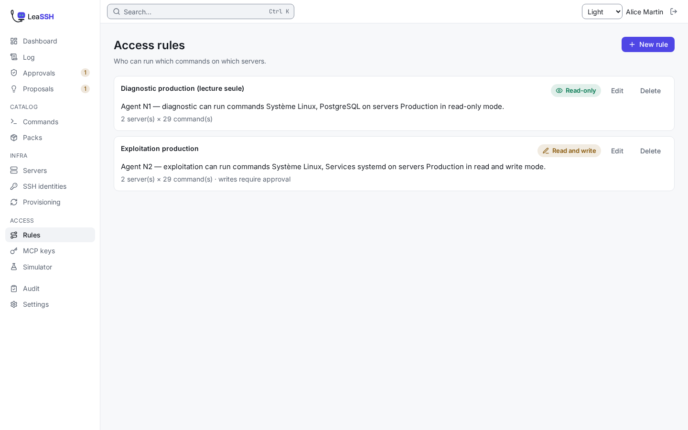
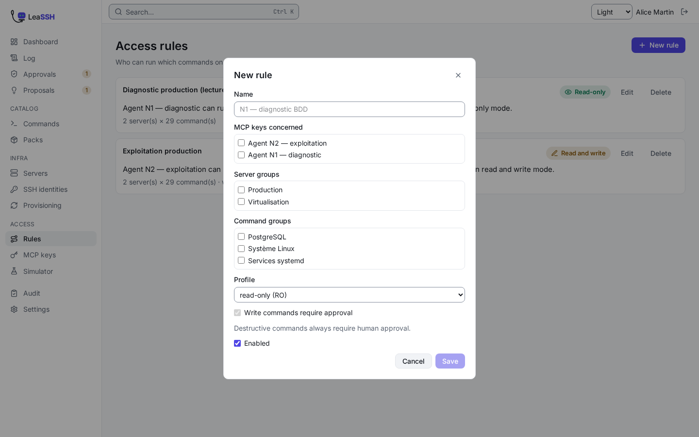
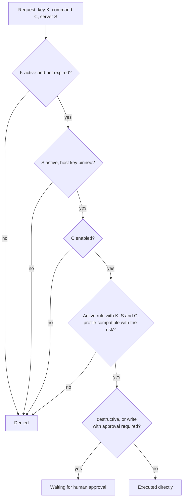

**English** · [Français](../fr/regles-d-acces.md)

# Access rules

**Who**: read for everyone; manage: `admin`. **Path**: `/regles`.

An **access rule** says *who can run which commands on which servers*. It is the only place where permissions are granted.

## Anatomy of a rule

- **Name**;
- a **set of server groups** and a **set of command groups** (at least one of each): the servers and commands covered are the **union** of the groups;
- a **profile**: `RO` (`read` commands only) or `RW` (`read` + `write` + `destructive`);
- **Approval of writes** (`write_requires_approval`, true by default);
- the **MCP keys** concerned;
- an active state.

A rule's card summarises it in a sentence: "*Agent N2 — exploitation* can run the commands *Linux system, systemd services* on the servers *Production* in read and write", with the number of servers × commands covered and the "writes subject to approval" mention.

## How permissions are evaluated

A key `K` may run command `C` on server `S` if and only if:

1. `K` is active and not expired;
2. `S` is active and its host key is **pinned**;
3. `C` is enabled;
4. there is an active rule containing `K`, one of whose server groups contains `S` and one of whose command groups contains `C`, with a profile compatible with `C`'s risk.

**Human approval** is required if `C` is `destructive` (always), or `write` with `write_requires_approval` true. If several rules allow the same combination, the **least restrictive** applies and its identifier is logged.

## Common gestures

- Start with an `RO` rule on a limited server group, check with the [Simulator](simulator.md), then widen.
- Separate agents: a diagnostic rule (RO) and an operations rule (RW) with different keys.

## Good to know

- Changing or deleting a rule takes effect immediately, including on an approval already pending (re-checked at execution).
- Every change is in the administration log, with its diff.

---

[← Previous : Command packs](packs.md) · [Home](README.md) · [Next : MCP keys →](mcp-keys.md)
