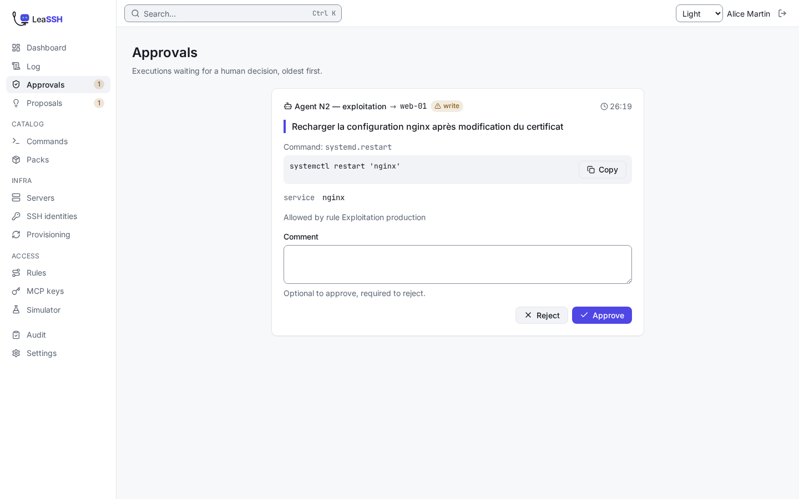
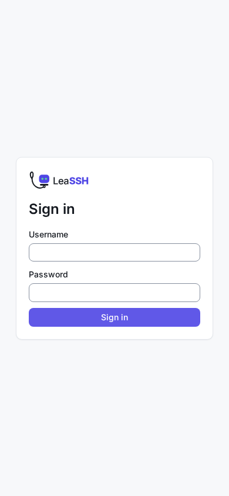

**English** · [Français](../fr/validations.md)

# Approvals

**Who**: `admin` and `approver` (viewers do not see the buttons). **Path**: `/validations`.

## When is approval requested?

- A `destructive` command: **always**, whatever the rule's profile.
- A `write` command: if the rule requires approval of writes (the default).

The agent receives `pending_approval` and follows the state with `get_execution(wait_seconds)`: it waits for your decision.

## One card per request (oldest first)

- **Who and where**: the agent (MCP key) → server, with the risk badge;
- **Countdown** before expiry (30 minutes by default, configurable in [Settings → General](settings.md)): after that the request becomes `expired` and nothing runs;
- **The reason** given by the agent;
- **The command** (identifier) and the **exact rendered line**, with a *Copy* button;
- **The validated parameters**;
- **The rule** that allows the request;
- a **Comment** field: optional to approve, **required to reject**;
- the **Reject** and **Approve** buttons.

## What happens on approval?

Leassh **re-checks** just before executing: key still active, rule still valid, template hash identical. If any of these changed since the request, the execution goes to `error` with the reason, running nothing. The decision is recorded atomically with its audit event (who, when, comment).

## On mobile

A webhook (Mattermost, Slack…) can notify you as soon as an approval is pending (see [Settings → Webhook](settings.md)).

## Good to know

- Read the **rendered line**: it is what will really be sent.
- A rejection with a comment is visible in the [Log](log.md) and to the agent.

---

[← Previous : Log](log.md) · [Home](README.md) · [Next : Proposals →](proposals.md)
