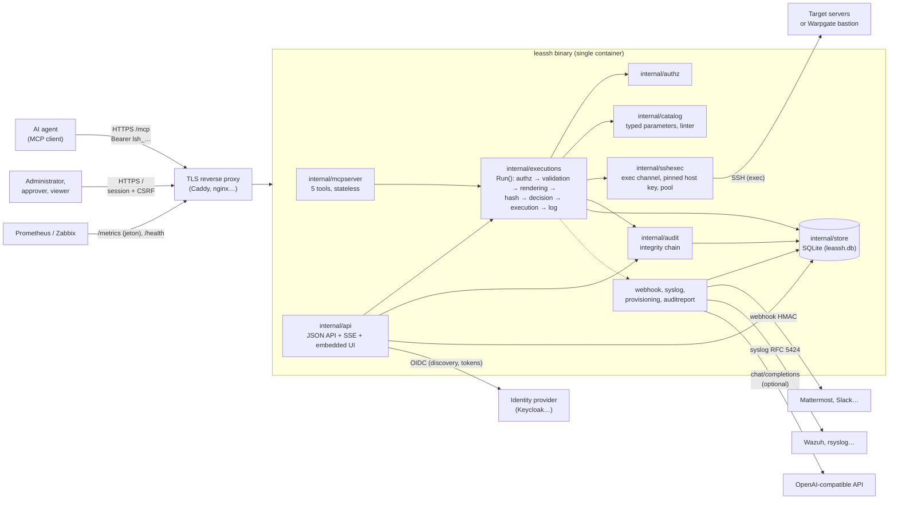

**English** · [Français](../architecture.md)

# Architecture

English translation of [`docs/architecture.md`](../architecture.md), the French reference versioned with the code. Update both in the same merge request.

## Components

A single process, a single container ([ADR 0002](../adr/0002-binaire-unique-front-et-back.md)): the React front end is embedded in the binary. Stack: Go and SQLite ([ADR 0003](../adr/0003-choix-de-la-stack-go-sqlite.md)).

## Main flow: `run_command`

1. The agent calls `run_command(server, command, params, reason)` on `/mcp` with its key.
2. `executions.Run()` — the **only execution path** — checks permissions (`authz`), validates each parameter against its type, renders the template with POSIX escaping, verifies the template hash, then decides: execute, queue for human approval, or deny.
3. In every case, an `executions` row is written (denials included), hash-chained.
4. If approval is required, a human approves or rejects in the interface (Approvals screen); a decision is atomic with its audit event.
5. Execution opens an SSH `exec` channel (never a shell nor a PTY) after strict host key verification, captures a truncated output, writes the result.
6. Observers (webhook, syslog) are notified; they cannot run anything.

## Trust boundaries

| Boundary | Who crosses | Control |
|---|---|---|
| Internet / network → reverse proxy | Everyone | TLS; `X-Forwarded-*` trusted only from declared proxies |
| Proxy → `/mcp` | AI agents (untrusted) | MCP key (hash in database, constant-time comparison), 60 tool calls/min, closed catalogue, human approval of writes |
| Proxy → API/interface | Authenticated humans | `HttpOnly` session cookie + CSRF, roles `admin`/`approver`/`viewer`, OIDC SSO, persistent failure limiter |
| Leassh → target servers | Validated commands | `exec` channel only, pinned host key, dedicated SSH user recommended |
| Leassh → outgoing URLs (webhook, AI, OIDC, bastion) | Configured by an admin | `http(s)` only, redirects not followed (webhook, AI), remote bodies not relayed |
| Disk | Whoever reads the database | Secrets encrypted AES-256-GCM with `LEASSH_MASTER_KEY` (outside the database); passwords in argon2id; MCP tokens hashed |

A **command output** is untrusted data returned to the agent (prompt injection possible): the effect remains bounded by the catalogue, the key's rights and human approval.

## Stored data and retention

| Data | Table(s) | Sensitive | Retention |
|---|---|---|---|
| Accounts (username, display name, role, argon2id hash, SSO link `(issuer, sub)`) | `users` | Personal | Until an admin deletes the account |
| Sessions | `sessions` | Yes | Configurable lifetime (12 h by default), 30 min inactivity; an expired session is refused, its row is deleted at sign-out or account deletion (no periodic purge of abandoned sessions) |
| Sign-in failures (IP, account) | `login_failures` | Personal (IP) | 15 min window; stale rows are deleted by the limiter |
| SSH identities (encrypted private key) | `identities` | **Secret** | Until deleted |
| Servers, groups, host key fingerprints | `servers`, `server_groups`… | No | Until deleted |
| Catalogue (commands, groups, proposals) | `commands`, `proposals`… | No | Until deleted |
| MCP keys (hash, prefix, expiry) | `mcp_keys` | Yes (hash) | Until deleted; the token is never kept in clear |
| Executions (agent, server, rendered command, parameters, reason, approver, output) | `executions` | Personal (approver), sometimes sensitive (output) | **Configurable retention, 365 days by default, 0 = unlimited**; daily purge (`logs.purge` event) |
| Administration log (actor, action, secret-free diff, IP) | `audit_events` | Personal | Same retention as above |
| Audit reports (snapshot, AI summary) | `audit_reports` | Aggregates | Cannot be deleted from the interface |
| Webhook deliveries | `webhook_deliveries` | No | Last 200 viewable |
| Settings (SSO, syslog, webhook, AI, general) | `oidc_config`, `syslog_config`, `app_settings`… | Secrets encrypted | Until changed |
| Application logs (JSON, standard output) | — | No secret nor MCP argument content | According to your log collector |

### Personal data (level N3)

- **Nature**: users' usernames and display names, clients' IP addresses, the identity of the agent and of the approver. Leassh itself collects no sensitive data in the GDPR sense; **command outputs** may contain some depending on your catalogue.
- **Purpose and legal basis**: systems security and access traceability (the organisation's legitimate interest); to be confirmed by the data controller of the organisation deploying Leassh.
- **Minimisation**: the AI summary only receives aggregates; syslog and the webhook never send command outputs; CSV export does not include outputs.
- **Erasure**: deleting an account is possible; the log keeps the actor's name until the end of retention, because the integrity chain forbids rewriting a row ([ADR 0004](../adr/0004-chaine-integrite-du-journal.md)). To erase earlier, reduce retention. This limit must appear in your organisation's retention policy.

## Observability

`/health` (probe), `/metrics` (Prometheus, closed until a token is set), including outgoing call duration (`leassh_outbound_duration_seconds{target,result}`). JSON logs on standard output.

---

[← Previous : Operations: update, backup, monitoring](operations.md) · [Home](README.md) · [Next : API reference →](api-reference.md)
