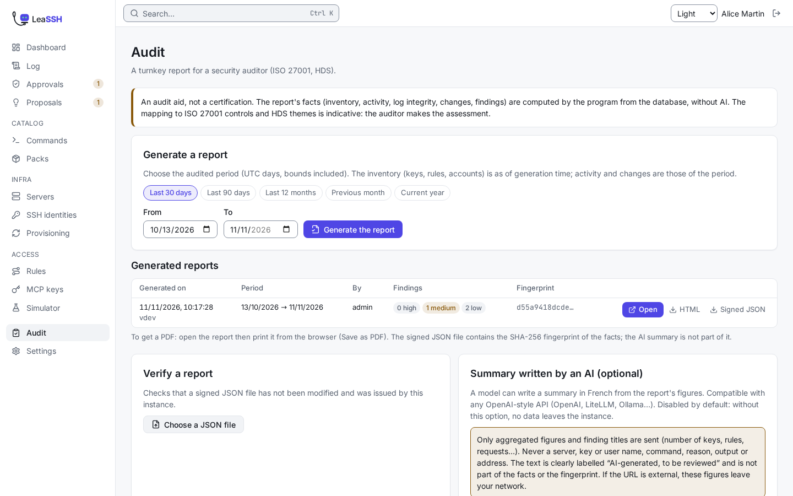

**English** · [Français](../fr/audit.md)

# Audit report (ISO 27001, HDS)

**Who**: `admin`. **Path**: `/audit`.

This screen produces a **turnkey report for a security auditor** in a few clicks. It is an **audit aid, not a certification**: the mapping to controls is indicative, the auditor judges.

## Generate a report

Choose the period (*last 30 days*, *last 90 days*, *last 12 months*, *previous month*, *current year*, or *From / To* dates in UTC, bounds included, 400 days maximum), then **Generate**. The inventory (keys, rules, accounts) is that of the **moment of generation**; activity and changes are those of the **period**.

## Report contents

- **Configuration**: retention, approval expiry, HTTPS, webhook;
- **Scope**: servers, groups, commands by risk and origin, MCP keys (state, expiry, last use), RO/RW rules with or without approval, accounts, identities, connectors;
- **Activity**: outcomes, denials by cause, human approvals (delay, approver), writes without approval, detailed destructive requests, security events;
- **Integrity**: full verification of both hash chains, sequence range, **chain head**, retention, purges;
- **Administration changes** (at most 1,000 listed, exact totals);
- Automatic **findings** with severity (high, medium, low, information): RW rule without approval, keys without expiry or unused for 90 days, inactive admin, server without pinned host key, integrity break, retention under 365 days, interface without HTTPS, no webhook, a single administrator, password identities, synchronisation failures… Thresholds are **indicative**;
- **Mapping** to 14 controls of ISO/IEC 27001:2022 annex A and 4 HDS themes (traceability, authorisations, retention, partitioning, without clause number). Statuses: "evidence elements", "minor points", "points of attention" — **never a compliance verdict**.

The **facts** are computed deterministically from the database, **without AI**: two computations of the same state give the same JSON byte for byte.

## Export and hand over to the auditor

- **Open**: a standalone HTML page (no script, no external resource), printable to PDF from the browser;
- **Signed JSON**: `{format: "leassh-audit-report/1", signature, snapshot}`. `signature.digest` is the SHA-256 of `snapshot`'s compact JSON: the auditor recomputes it with `jq -cj .snapshot report.json | sha256sum`. `signature.tag` is an HMAC derived from the master key: only your instance can recompute it;
- **Verify a report**: drop the file; Leassh answers `digest_ok` and `tag_ok` (the file does come from your instance);
- also hand over the logs' **chain head** shown in the report: it lets a later truncation be detected.

## AI-written summary (optional)

Disabled by default. In the screen (or via the `LLM_BASE_URL`, `LLM_MODEL`, `LLM_API_KEY` variables as defaults): URL of an **OpenAI-compatible API** (OpenAI, LiteLLM, Ollama…), model and key (encrypted, never returned).

- **Privacy**: only **aggregated numbers and fixed labels** are sent (number of keys, rules, requests, findings). Never a server, key, user or command name, never a reason, output or address. If the URL is external, those numbers **leave your network**.
- The text is labelled "AI-generated, to be reviewed", stored **outside the report's digest**, in the chosen language, and not retranslated afterwards.

## Good to know

- Reports **cannot be deleted**; each generation is in the administration log.
- Log retention (365 days by default) limits the auditable period.
- The report's content (facts, labels) is not translated.

---

[← Previous : Access simulator](simulator.md) · [Home](README.md) · [Next : Settings →](settings.md)
