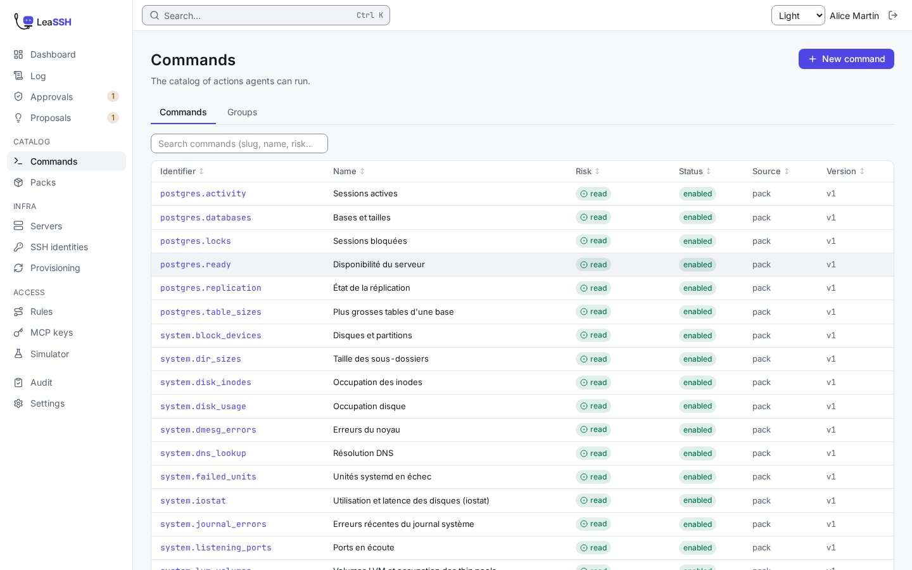
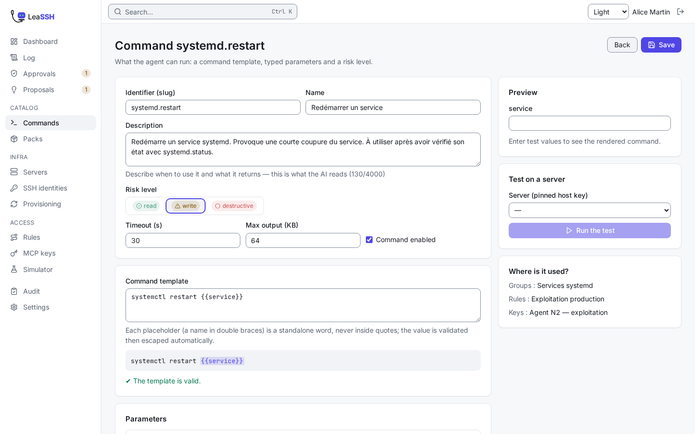

**English** · [Français](../fr/commandes.md)

# Commands and command groups

**Who**: read for everyone; create, edit, test: `admin`. **Path**: `/commandes` (*Commands* and *Groups* tabs).



The **catalogue** is the allow-list of everything agents can run. Columns: identifier, name, risk (read, write, destructive), status (enabled or not), source (`pack`, `manual`, `proposal`) and version. Each change increments the version and changes the command's hash.

## The command editor



- **Identifier (slug)** and **name**;
- **Description**: read by the AI. Write *when to use it* and *what it returns* (up to 4,000 characters);
- **Risk level**: read, write or destructive ([meaning](overview.md));
- **Timeout** (seconds): on expiry, a signal then channel closure, status `timeout`;
- **Max output** (KB): beyond it, output is truncated (`truncated` flag);
- **Command enabled**: a disabled command can no longer be run;
- **Command template** with its `{{name}}` placeholders, validated live ("✔ The template is valid");
- typed **Parameters**, one per placeholder;
- on the right: **Preview** (enter test values to see the rendered command), **Test on a server** (a server with a pinned host key; produces a logged execution with `actor = user`, with no access rule and no approval) and **Where is it used?** (groups, rules, keys).

### Template writing rules

- A placeholder is a **standalone word**, never inside quotes: ✅ `journalctl -u {{service}}` ✅ `--unit={{service}}` ❌ `echo "{{x}}"` ❌ `/var/log/{{name}}.log` (use a `path` parameter).
- All placeholders are declared, and all parameters are used.
- Shell metacharacters (`;`, `&`, `|`, `>`, `<`, `$(`, backtick) are **warnings** for an administrator and **errors** for a proposal. *Structure* errors (quoted placeholder, glued to text, placeholder as first word, undeclared) always block, because they guarantee escaping safety.

### Parameter types

| Type | Validation | Options |
|---|---|---|
| `enum` | value from a list | `values` (required) |
| `int` | integer within bounds | `min`, `max` (required) |
| `identifier` | `^[A-Za-z0-9._@-]{1,64}$`, does not start with `-` | `max_length` |
| `service` | `^[A-Za-z0-9@._:-]{1,128}$`, does not start with `-` | |
| `path` | absolute, normalised, no `..`, prefixed by an allowed prefix | `allowed_prefixes` (required) |
| `regex` | matches the pattern (auto-anchored), does not start with `-` | `pattern`, `max_length` |

Common: `description` (read by the AI), `required` (true by default), `default`. **There is no "free text" type.** At execution, the value is validated then inserted **escaped** (single quotes, `'` becomes `'\''`).

### Example

```yaml
- id: systemd.restart
  name: Restart a service
  description: >
    Restarts a systemd service. Causes a few seconds of downtime.
    Use after checking the state with systemd.status.
  risk: write
  template: systemctl restart {{service}}
  params:
    service: { type: service, description: "Name of the systemd unit" }
```

## Command groups

The **Groups** tab groups commands (often created when importing a [pack](packs.md)). A group is attached to [access rules](access-rules.md).

## Good to know

- A command with no group, or whose group is in no rule, can be run by nobody.
- Administrators can write commands with pipes (`ps aux | sort`): a warning is shown, an agent proposal is refused.
- The **test** from the editor really runs the command on the chosen server.

---

[← Previous : Provisioning (Warpgate bastion)](provisioning.md) · [Home](README.md) · [Next : Command packs →](packs.md)
