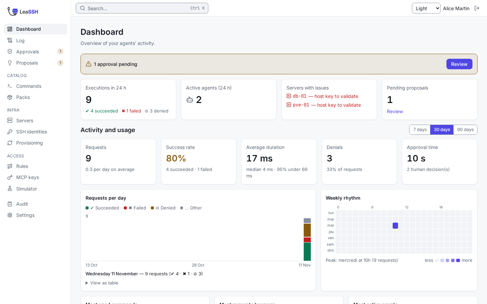

**English** · [Français](../fr/tableau-de-bord.md)

# Dashboard

**Who**: all roles (read-only). **Path**: `/`.

## What the screen shows

- **Welcome checklist** (fresh instance): six steps ticked automatically (identity, server with pinned key, commands, rule, MCP key, connected agent). "Connected agent" means an MCP key has already been used.
- **Alert banner**: number of pending approvals, with the *Review* button leading to [Approvals](approvals.md).
- **Four tiles**: executions over 24 h (succeeded, failed, denied), active agents over 24 h, **servers with issues** (host key to confirm or mismatching, failing connection), pending proposals.
- **Activity and usage** (7 / 30 / 90 days toggle): requests, success rate, average duration (median, 95th percentile), denials, average human approval delay; stacked bars per day (succeeded, failed, denied, other) with an equivalent table (*View as table*); week × hour heat map; rankings of the most used commands, servers and agents; slowest commands; main denial causes.

Colours are always paired with an icon or text (accessibility).

## Common gestures

- Click *Review* to handle a pending approval.
- Click a server with issues to fix it (typically: test the connection and pin the host key).
- Change the period to compare 7, 30 or 90 days.

## Good to know

- Heat map hours are grouped in your browser's time zone.
- A low success rate is not always a problem: denied commands count among "requests".

---

[← Previous : Sign-in and setup](sign-in.md) · [Home](README.md) · [Next : Log →](log.md)
