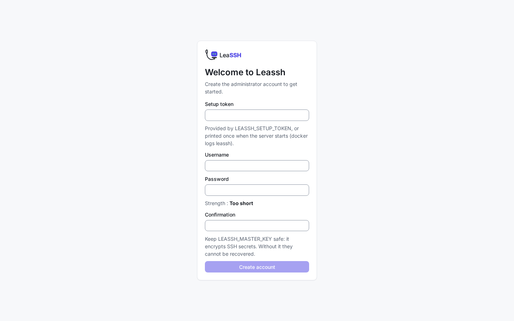

**English** · [Français](../fr/premiers-pas.md)

# Getting started

The **dashboard** shows a welcome checklist that ticks itself. Here is the full path, from setup to the first execution.

## 1. Create the administrator account

Enter the **setup token** (the `LEASSH_SETUP_TOKEN` variable, or a random token printed only once in the logs on first start: `docker logs leassh` or `journalctl -u leassh`), a username and a password of at least 10 characters. As long as no account exists, this token prevents the first person who reaches the instance from becoming administrator.

## 2. Create an SSH identity

**SSH identities → New identity**: give it a name and the SSH user, then choose *Generate an ed25519 key*. Copy the public key line shown.

## 3. Authorise the key on the target servers

On each server: `echo '<public key>' >> ~/.ssh/authorized_keys` (a dedicated user is recommended, see [Installation](installation.md) §8).

## 4. Add a server and pin its host key

**Servers → Add a server** (short id, name, address, port, identity). Click **Test connection**: Leassh shows the fingerprint of the host key presented. Compare it with your server's real fingerprint (`ssh-keygen -lf /etc/ssh/ssh_host_ed25519_key.pub`), then **Trust this key**. Without a pinned fingerprint the server stays "unknown" and unusable.

## 5. Install a command pack

**Packs** → *Linux system* → **Install** (tick the option to create the command group): the preview lists the commands before import.

## 6. Create a server group

**Servers → Groups**: a group containing your servers (e.g. "Production").

## 7. Create an access rule

**Rules → New rule**: server group + command group + `RO` profile (read-only) to begin with.

## 8. Create an MCP key

**MCP keys → New key**, attach the rule, then **copy the token**: it is shown only once.

## 9. Connect the agent

Paste the configuration into your agent (see [MCP agents and tools](mcp-agents.md)) and ask it to list the servers. The first execution appears in the **Log**.

## 10. Check with the simulator

The **Access simulator** shows at any time, for a key, what it can do and why. Use it before handing a key to an agent.

Next steps: [write your own commands](commands.md), [set up SSO](sso.md), [send logs to your SIEM](settings.md), [schedule the backup](operations.md).

---

[← Previous : Installation](installation.md) · [Home](README.md) · [Next : User manual →](user-manual.md)
