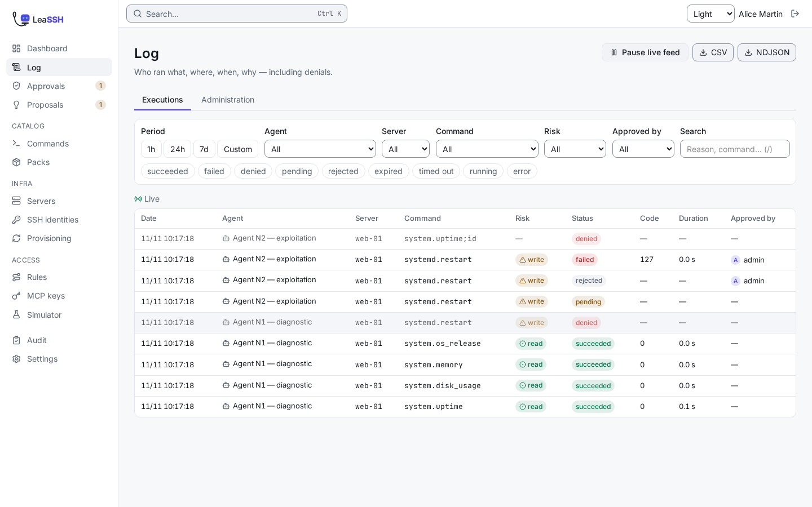
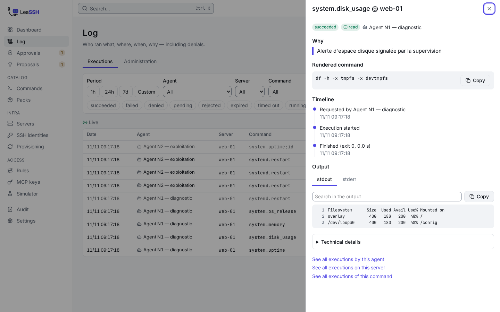
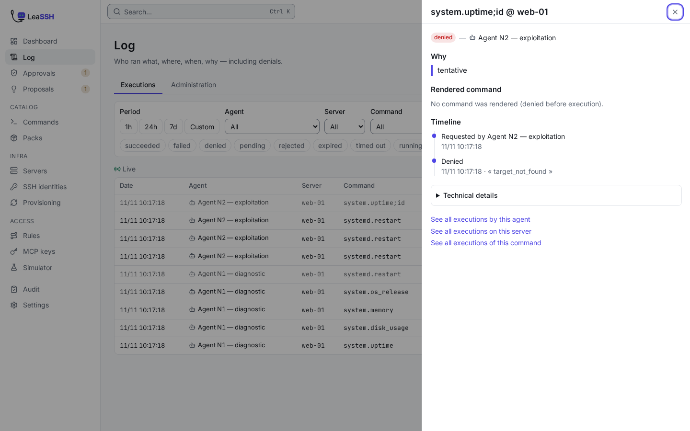
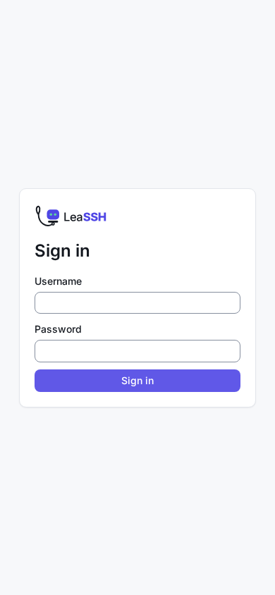

**English** · [Français](../fr/journal.md)

# Log

**Who**: all roles (read-only). **Path**: `/journal`. The screen answers: *who ran what, where, when, why, with what result, and who approved it?*

## Two tabs

- **Executions**: every `run_command` call, **including denials** (invalid parameter, unauthorised server, expired key…).
- **Administration**: every configuration change, successful or failed sign-in and sensitive action, with a **before/after diff** (secrets masked).

## Filters

Period (1 h, 24 h, 7 d, custom), agent, server, command, status (succeeded, failed, denied, pending, rejected, expired, timed out, running), risk, approver and free-text search (reason, rendered command). Filters are **in the page address**: you can share a filtered link.

## Live view and export

- **Live**: the log updates by itself (Server-Sent Events). *Pause live* freezes the display. Behind a reverse proxy, buffering must be turned off for `/api/v1/executions/stream` (see [Installation](installation.md)).
- **CSV** and **NDJSON**: export the filtered result. CSV neutralises spreadsheet formulas and does not include command outputs.

## The detail drawer

Click a row to open the detail:

- **Why**: the reason given by the agent;
- **Rendered command**: the exact line sent to the server (validated and escaped parameters);
- **Timeline**: requested, approved or rejected (by whom, with what comment), executed;
- **Output** (stdout and stderr, truncated to the command's maximum size), exit code and duration;
- **Technical details**: authorising rule, command version and hash, client IP address, MCP session id, User-Agent, execution id;
- links *See all executions of this agent / on this server / of this command*.

A denied execution shows the reason for the denial (e.g. `target_not_found`, `param_invalid:service`, `key_expired`):

## Mobile

## Good to know

- Logs **cannot be edited** from the interface. Only **automatic retention** purges them (365 days by default, configurable in [Settings → General](settings.md)).
- `list_servers`, `list_commands` and `get_execution` calls create no row (to avoid noise) but update the key's "last used".
- Integrity is checked in **Settings → General → Verify integrity**.

---

[← Previous : Dashboard](dashboard.md) · [Home](README.md) · [Next : Approvals →](approvals.md)
