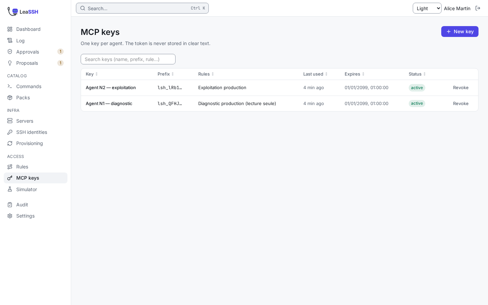
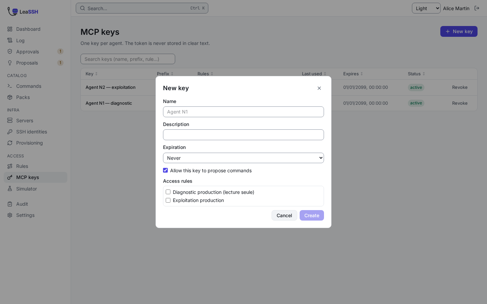

**English** · [Français](../fr/cles-mcp.md)

# MCP keys

**Who**: read for everyone; manage: `admin`. **Path**: `/cles`.

An **MCP key** is an agent's identity: "one key per agent". Columns: name, **prefix** (`lsh_QFHJ…`), attached rules, last use, expiry, status (*active*, *expired*, *revoked*) and the *Revoke* action.

## Create a key

*New key*: name, description, **expiry** (recommended), **can propose** option (allows the `propose_command` tool) and attached rules.

> **The token (`lsh_…`) is shown only once**, at creation. Copy it right away: Leassh keeps only its hash, compared in constant time. It can never be read again.

## Use the key

In the agent's MCP configuration, header `Authorization: Bearer lsh_…` (see [MCP agents and tools](mcp-agents.md)).

## Revoke, expire, disable

- *Revoke*: the key has no rights at all. The token is still recognised so attempts can be logged (`key_inactive`, `key_expired`) but allows nothing.
- An expired key is treated the same way.
- A key that fails to authenticate produces a `key.auth_failed` event (prefix only).

## Limits and security

- **60 tool calls per minute per key** (sliding window); beyond that, HTTP 429 with `Retry-After`. The protocol handshake is not counted.
- A key can **change nothing**: neither configuration, nor approvals, nor read another key's executions.
- MCP keys never go through SSO.

## Good to know

- Give each agent its own key: the log and the simulator then let you attribute everything.
- Rotate by creating a new key, deploying it, then revoking the old one.

---

[← Previous : Access rules](access-rules.md) · [Home](README.md) · [Next : Access simulator →](simulator.md)
