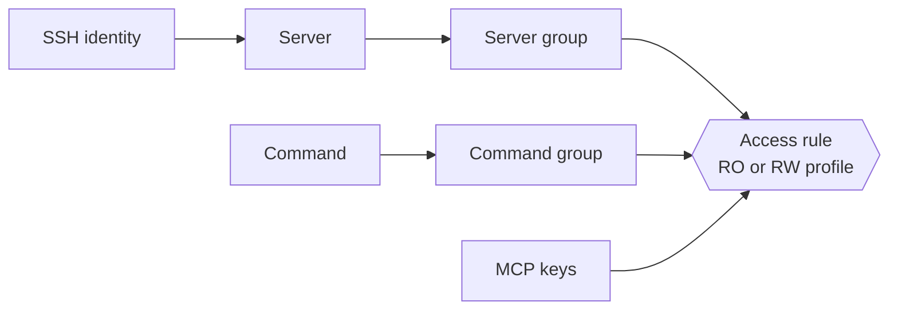

**English** · [Français](../fr/presentation.md)

# Overview and concepts

## What is Leassh for?

Leassh is an open source **MCP** (Model Context Protocol) server that gives AI agents **SSH access limited to a catalogue of validated commands**. The agent never gets a shell: it *chooses* a command from a catalogue you wrote or approved, with typed and validated parameters. Every request — allowed, denied or waiting for human approval — is logged.

The problem it solves: filtering an agent's commands after the fact (blacklists, regular expressions on the command line) can be bypassed (`rm` is blocked, but `find -delete`, `python -c`, `truncate` or `$( )` get through). Leassh reverses the logic: **allow-list**, typed then escaped parameters, explicit permissions, human approval of sensitive actions and a business-level log.

| Classic approach | Leassh |
|---|---|
| The agent writes a command, we try to filter it | The agent picks a command from a catalogue |
| Blacklist: anything not forbidden goes through | Allow-list: nothing goes through unless planned |
| Free-form parameters | Typed, validated, then escaped parameters |
| Raw SSH logs | Business log: agent, server, command, parameters, reason, result, approver |

## Who is it for?

| Role | What they do with Leassh |
|---|---|
| **Administrator** | Declares servers and SSH identities, writes or imports commands, creates access rules and MCP keys, configures the application. |
| **Approver** | Approves or rejects pending executions from the interface (mobile included). |
| **Viewer** | Reads configuration and logs, changes nothing. |
| **AI agent** | Connects with an MCP key and only has five tools. |
| **Auditor** | Receives an audit report and can verify the log's integrity. |

## Concepts

- **SSH identity**: an SSH account (user + ed25519 private key generated by Leassh or imported) that Leassh uses to connect. The private key is encrypted at rest.
- **Server**: a machine reachable over SSH (host, port, identity). Its **host key** is pinned: any mismatch blocks the server.
- **Server group**: a set of servers (e.g. "Production").
- **Command**: a command template (`systemctl restart {{service}}`), typed parameters, a risk level and a description read by the AI.
- **Command group**: a set of commands, often created when importing a pack.
- **Access rule**: links server groups, command groups and MCP keys, with a **profile**.
- **MCP key**: an agent's identity. The token (`lsh_…`) is shown only once; only its hash is stored.
- **Pack**: a YAML command catalogue, importable and shareable (system, systemd, MySQL, PostgreSQL, nginx, Docker, pfSense, Proxmox, UniFi).
- **Proposal**: a command suggested by an agent, to be reviewed before any execution.

### Risk levels and profiles

| Risk | Meaning | Human approval |
|---|---|---|
| `read` | Read-only (status, logs, diagnostics) | Never |
| `write` | Changes something (restart a service…) | Yes by default (rule setting) |
| `destructive` | May cut a service or lose data | **Always**, whatever the profile |

- **`RO`** profile: `read` commands only.
- **`RW`** profile: `read` + `write` (approval required by default for `write`).

### What is never possible

- No PTY, no interactive shell: SSH `exec` channels only (no agent forwarding, no port forwarding, no X11).
- No free-text parameter: every value is validated against its type, then escaped.
- An MCP key cannot change anything: neither configuration nor approvals.
- Secrets are never logged nor returned by the API.

See the [Security](security.md) page for the full model.

## Features

- Typed command catalogue, editor with preview, test from the editor
- Servers, SSH identities, host key pinning, groups
- MCP keys, access rules, access simulator
- Human approval (mobile included) and command proposals
- Full execution and administration log with integrity chain, export and live view
- YAML packs (9 provided), HMAC-signed webhook, syslog export (UDP/TCP/TLS, RFC 5424, text/JSON/CEF)
- Server provisioning from a Warpgate bastion
- ISO 27001 / HDS audit report, optional AI summary
- OpenID Connect SSO (Keycloak, Entra ID, Authentik, Google…)
- French and English interface, light and dark themes
- A single binary or a Docker image; SQLite by default

---

[Home](README.md) · [Next : Installation →](installation.md)
