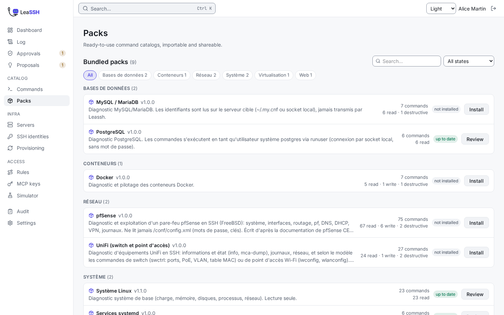

**English** · [Français](../fr/packs.md)

# Command packs

**Who**: read for everyone; install and export: `admin`. **Path**: `/packs`.



A **pack** is a YAML command catalogue, importable and shareable. Nine packs are built into the binary:

| Category | Packs |
|---|---|
| System | `system`, `systemd` |
| Databases | `mysql`, `postgres` |
| Web | `nginx` |
| Containers | `docker` |
| Network | `pfsense` (75 commands), `unifi` (27: switch and access point) |
| Virtualisation | `proxmox` (60 commands) |

## The screen

Search (name, description, command ids), filters by **category** and **state** (*not installed*, *up to date*, *update available*), one row per pack with the command count, the read / write / destructive split and the state.

## Install a pack

1. **Install**: a **preview** lists *new*, *modified* (with diff) and *unchanged* commands. Nothing is changed at this stage.
2. Tick **create the command group** named after the pack.
3. Confirm: the import is **atomic** (all or nothing).

A command already present and modified by the pack is updated (version incremented, source `pack`) keeping its enabled state. A provided pack is trusted; an imported file must have its linter warnings explicitly accepted. A linter **error** always blocks the import.

## Import or export a file

Import accepts a YAML file; export produces a pack from a group, a selection or the whole catalogue.

```yaml
pack:
  id: system
  name: Linux system
  version: 1.0.0
  description: Basic system diagnostics
  category: System         # optional
commands:
  - id: system.disk_usage
    name: Disk usage
    description: …
    risk: read
    template: df -h -x tmpfs -x devtmpfs
    params: {}
```

## Precautions for network and virtualisation packs

- No pack reads a secret (pfSense `/conf/config.xml`, `/etc/pve/priv`, UniFi configuration).
- Actions that cut traffic or data (`qm stop`, `pct stop`, snapshot rollback or deletion, `pfctl -F states`, reboots, `set-inform`) are `destructive`: human approval is always required.
- **These packs have not been run on real hardware**: they are validated by the linter and the import; a command missing from a firmware fails harmlessly.
- **pfSense**: the SSH account must accept commands (root or `/bin/sh` shell; the default `admin` user opens the console menu). **Proxmox**: one server per node, `root@pam` account or one with `qm`, `pct`, `pvesh` rights. **UniFi**: enable SSH in the controller's device settings.

After import, add the command group to an [access rule](access-rules.md).

---

[← Previous : Commands and command groups](commands.md) · [Home](README.md) · [Next : Access rules →](access-rules.md)
