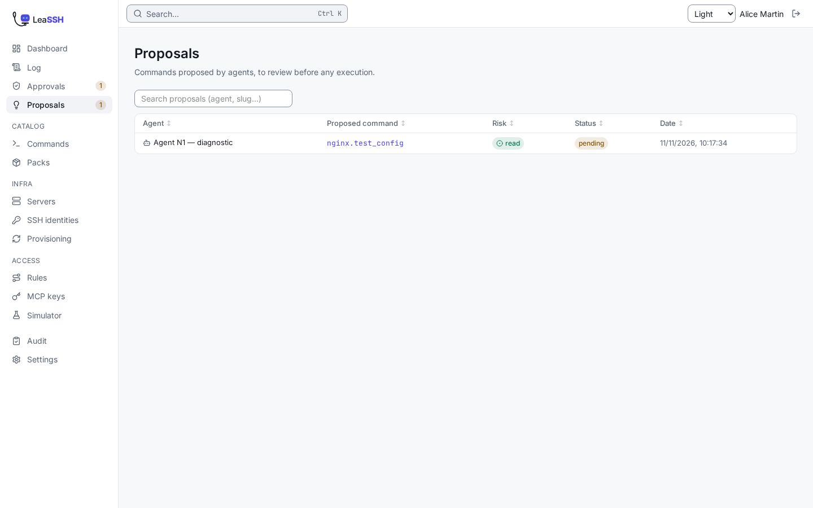
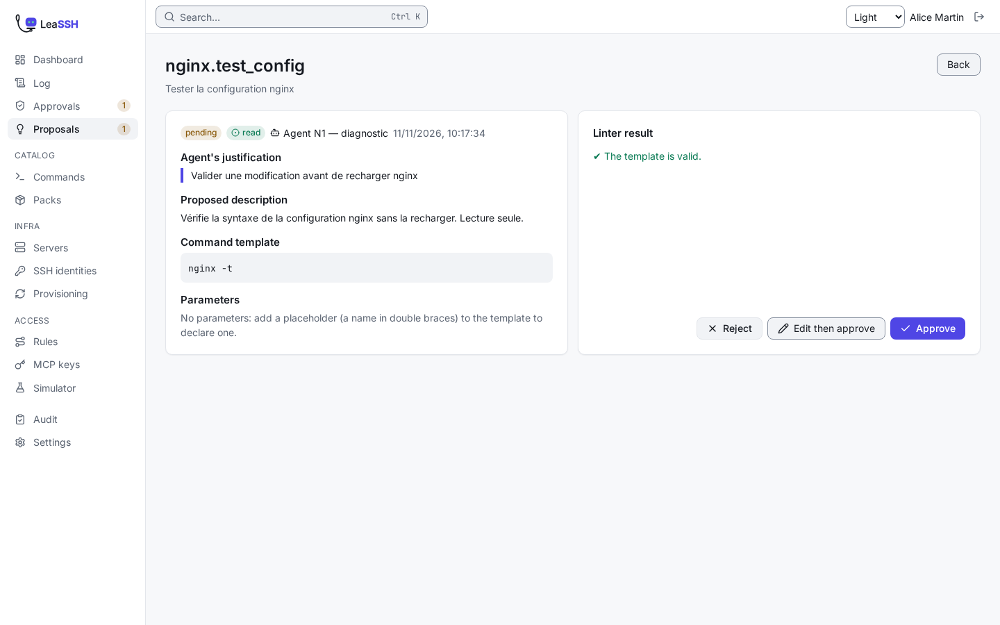

**English** · [Français](../fr/propositions.md)

# Proposals

**Who**: read for everyone; approve, edit and reject: `admin`. **Path**: `/propositions`.

An agent whose key has the *can propose* option calls the `propose_command` tool to suggest a new command (identifier, name, description, template, typed parameters, risk, **justification**). The proposal is **never executable** until an administrator approves it. A key can have at most 10 pending proposals.

## The list

Columns: agent, proposed command, risk, status (*pending*, *invalid*, *approved*, *rejected*), date. Sorting and search are available.

## A proposal's detail

- the proposed **template** and **parameters**;
- the **linter** result (blocking errors and warnings);
- the agent's **justification**.

Actions: **Approve**, **Edit then approve** (opens the command editor in proposal mode, with the strict linter, the final choice of risk level and groups), **Reject** (with a comment).

## The linter

A proposal whose template contains a shell metacharacter (`;`, `&`, `|`, `` ` ``, `$(`, `>`, `<`, newline), a non-standalone or quoted placeholder, an interpreter as first word (`sh`, `bash`, `python`, `sudo`, `xargs`…), an unknown type, or a template reduced to a placeholder is recorded as **invalid** and **cannot be approved without correction**. An administrator can write commands with pipes (with a warning); an agent never can.

## Good to know

- An approved command joins the catalogue with the `proposal` source. Remember to add it to a command group and a rule, otherwise no key will be able to run it.
- Review the proposal like code: it is what the agent will be able to run next.

---

[← Previous : Approvals](approvals.md) · [Home](README.md) · [Next : Servers and server groups →](servers.md)
