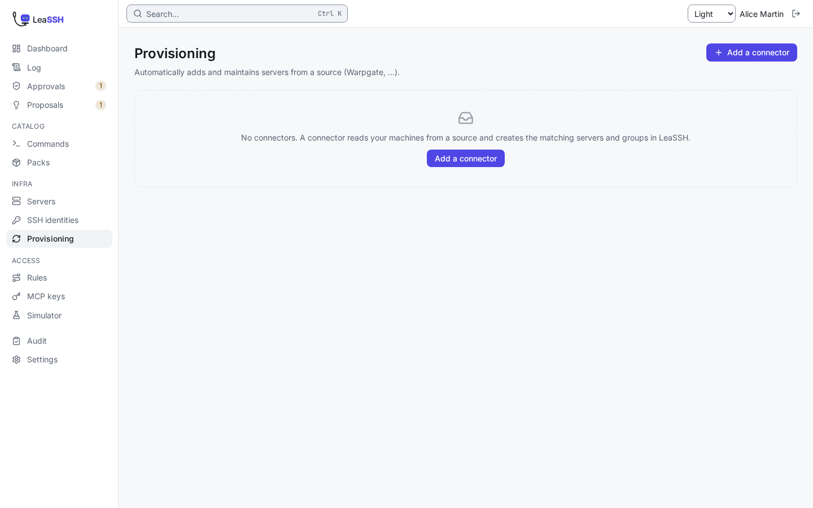

**English** · [Français](../fr/provisioning.md)

# Provisioning (Warpgate bastion)

**Who**: read for everyone; manage: `admin`. **Path**: `/provisioning`.

When your servers are already declared in an SSH bastion (**Warpgate**), a **connector** reads them and creates, updates and disables the matching servers and server groups in Leassh, instead of re-typing everything.

## Set up a connector

1. In Warpgate, choose (or create) a user whose role grants access to the wanted SSH targets and generate an **API token** for it. It does not need to be an administrator.
2. In Leassh: **Add a connector** — Warpgate URL, token, the bastion's SSH host and port, **SSH identity** (the one whose public key is declared on the Warpgate user) and, if needed, the default user.
3. **Test**, compare the bastion's host key fingerprint, then **Trust this key**: the machines of a bastion share its key, it is pinned once on the connector.
4. Optionally choose **default rules**: each *new* synchronised group is added to them once (immediate access for those rules' keys). Without a rule, no machine is reachable until an administrator creates one.
5. **Preview** then **Synchronise**. The preview does exactly the same computation as the application, then cancels it.

Periodic synchronisation is possible (`interval_min`, 0 = manual).

## Warpgate → Leassh mapping

| Warpgate | Leassh |
|---|---|
| Target name | Server name |
| Description | Description |
| — | `ssh_user` = `<user>:<exact target name>`, bastion host and port |
| Groups | Server groups (a target without group is imported without group) |

Only SSH targets are kept.

## Ownership rules

- A synchronised server or group is **locked** (name, id, host, port) and cannot be deleted; identity, SSH user, tags and state remain editable.
- A hand-edited SSH user is no longer overwritten by synchronisation (unless you tick *Follow sync*).
- A synchronised group accepts hand-added members; its synchronised members cannot be removed.
- Synchronisation **never** touches groups, memberships or rules created by an administrator.

## Life cycle and safeguards

- A machine that vanished from the source is **disabled** (never deleted, the log references it); if it reappears, it is re-enabled only if synchronisation had disabled it.
- A synchronisation that would disable **at least 3 machines and more than 30 %** of the fleet (or all of them if the source is empty) is **refused** (409 `sync_blocked`) unless confirmed (`force`).
- A host key mismatch (`mismatch`) is never cleared by a synchronisation; only a new pinning by the administrator lifts it.
- Deleting the connector keeps everything: objects become manual again.
- Each synchronisation that changes something writes a `provisioner.sync` audit event (change details). The API token is encrypted and never returned.

## Good to know

Warpgate blocks an IP after several authentication failures; Leassh pauses attempts for 60 s after a failure. If Warpgate's logs say "SSH auth from blocked IP", unblock Leassh's IP on the Warpgate side.

---

[← Previous : SSH identities](ssh-identities.md) · [Home](README.md) · [Next : Commands and command groups →](commands.md)
