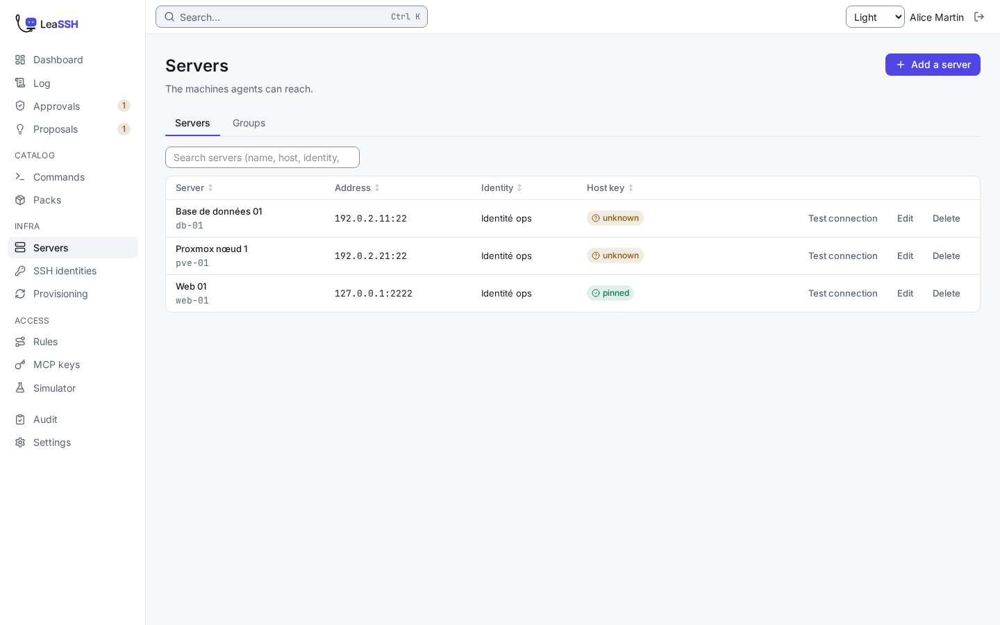
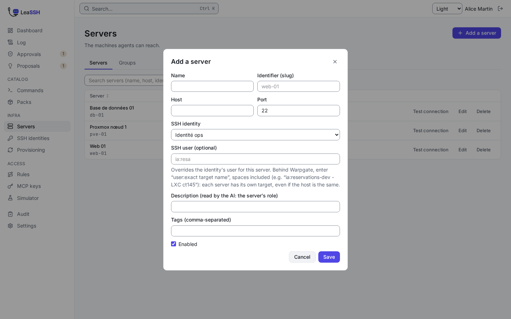

**English** · [Français](../fr/serveurs.md)

# Servers and server groups

**Who**: read for everyone; create, edit, delete: `admin`. **Path**: `/serveurs` (*Servers* and *Groups* tabs).

## Columns

Server (name and short id), address (host:port), SSH identity, **host key** and actions *Test connection*, *Edit*, *Delete*. Sorting and search are available.

### Host key states

| State | Meaning | Consequence |
|---|---|---|
| **unknown** | No pinned fingerprint | The server is **unusable** |
| **pinned** | The validated fingerprint matches | Usable |
| **mismatch** | The server presents another key | **Server blocked**, audit event, `host_key.mismatch` webhook |

## Add a server

Fields: short id (*slug*, stable, used by agents), name, address, port, SSH identity, description, **SSH user** (optional: overrides the identity's, useful behind a bastion), tags, active state.

## Pin the host key

1. **Test connection**: Leassh connects and shows the **fingerprint** presented (`SHA256:…`) and the key type.
2. **Compare it** with the server's real fingerprint: `ssh-keygen -lf /etc/ssh/ssh_host_ed25519_key.pub`.
3. **Trust this key**: pinning requires the confirmed fingerprint to still be the one presented at that moment.

If the key changes later (reinstall, attack), the server goes to **mismatch** and is blocked: check the fingerprint before choosing *Accept the new key*.

## Server groups

The **Groups** tab creates sets ("Production", "Virtualisation"…) used by [access rules](access-rules.md). A server can belong to several groups.

## Synchronised servers

A server created by a [provisioning connector](provisioning.md) carries the ↻ icon: name, id, host, port and description are locked (409 `managed`) and it cannot be deleted; identity, SSH user, tags and state remain editable.

## Good to know

- After an authentication failure, Leassh pauses attempts on that server for 60 s (`ssh_cooldown` status in the log) so as not to trigger an IP block by a bastion or fail2ban. Any change to the server lifts the pause.
- Deleting a server does not erase the log that cites it.

---

[← Previous : Proposals](proposals.md) · [Home](README.md) · [Next : SSH identities →](ssh-identities.md)
