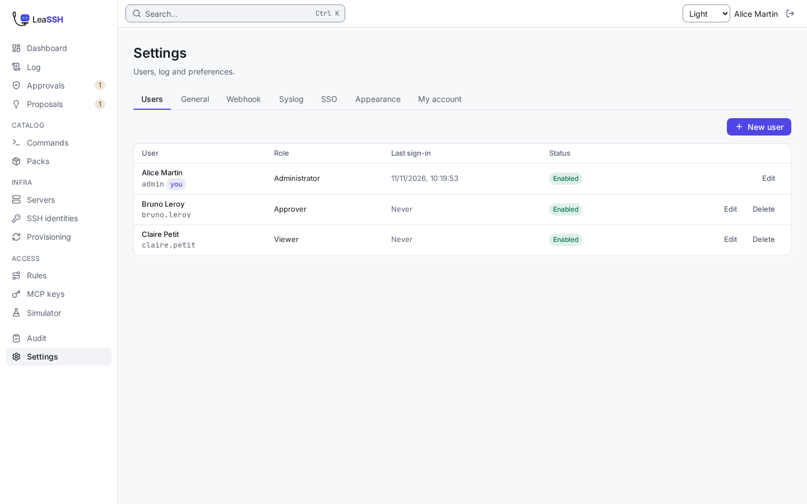
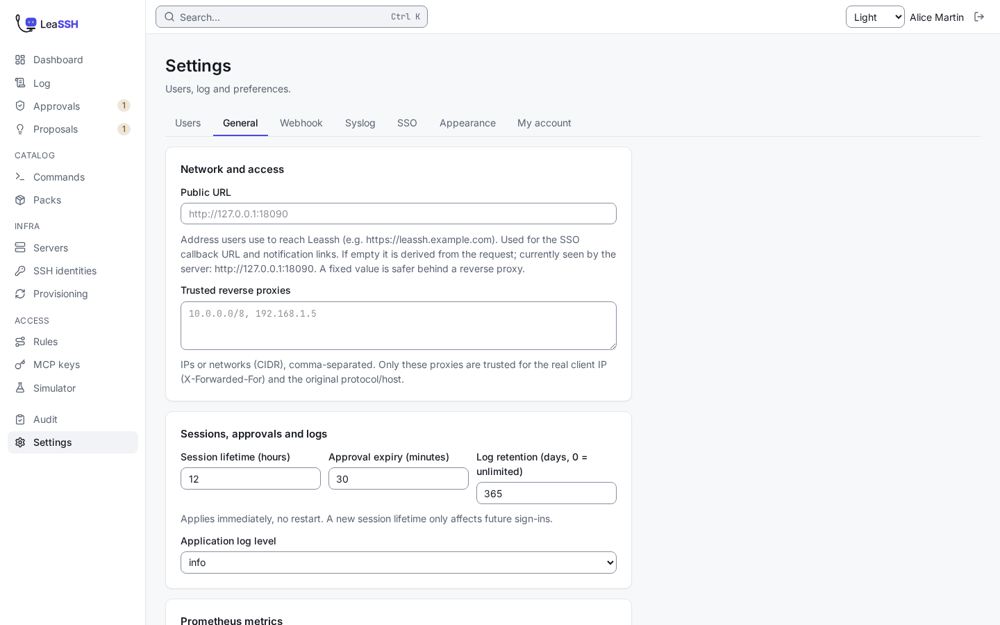
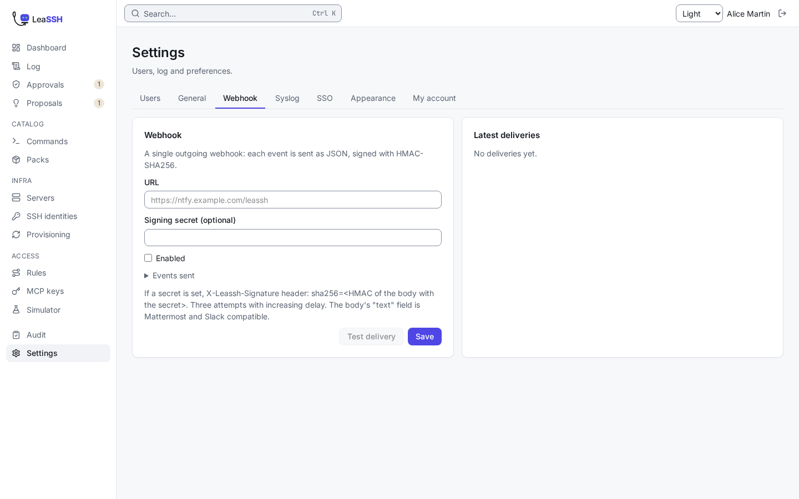
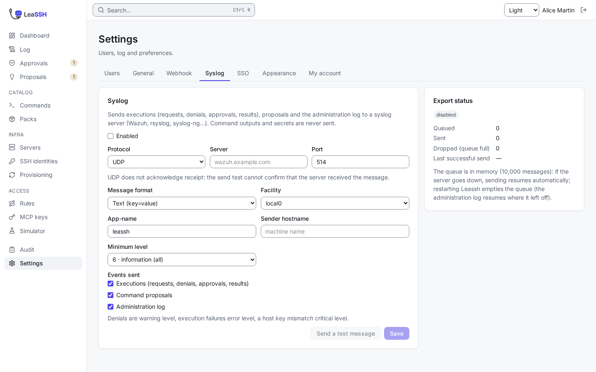
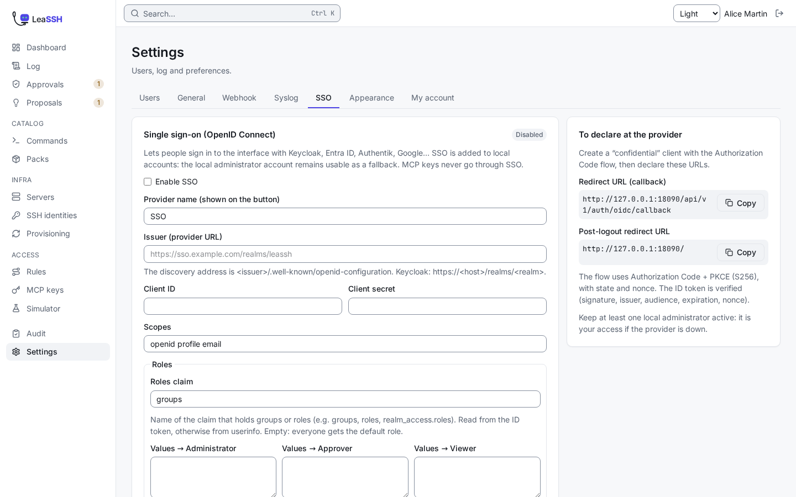
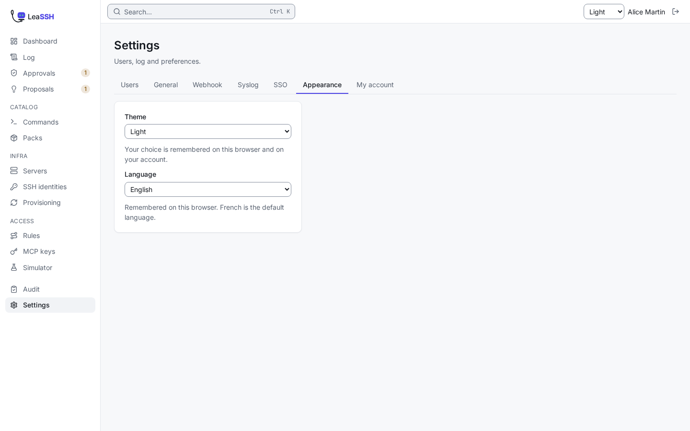
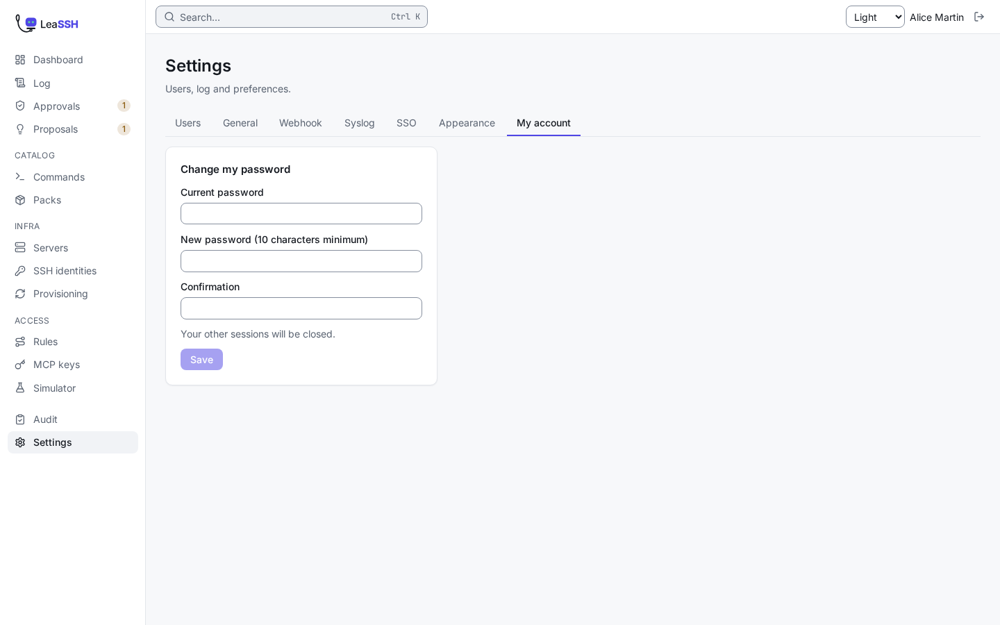

**English** · [Français](../fr/reglages.md)

# Settings

**Who**: everyone sees *Appearance* and *My account*; the other tabs are reserved for `admin`. **Path**: `/reglages`.

## Users

*New user*: username, display name, password (10 characters minimum), role (**Administrator**, **Approver**, **Viewer**). Actions: edit, reset password, disable, delete. Safeguards: you cannot disable or delete the **last active administrator** or disable yourself. Disabling an account, changing its role or password **closes its sessions**. An SSO account's role cannot be edited by hand (it comes from the provider).

## General

Stored in the database, applied live, audited:

| Setting | Purpose |
|---|---|
| **Public URL** | Users' address (e.g. `https://leassh.example.com`), used for the SSO return URL and notification links. Empty: deduced from the request. A fixed value is safer behind a proxy. |
| **Trusted reverse proxies** | IPs or CIDR networks trusted for `X-Forwarded-*`. Only these proxies give the client's real IP and the protocol. If your proxy is declared, it alone is responsible for HSTS. |
| **Session lifetime** | 12 hours by default (30 minutes of inactivity). |
| **Approval expiry** | 30 minutes by default. |
| **Log retention** | 365 days by default; 0 = unlimited. Daily purge (`logs.purge` event), never of pending or running requests. |
| **Application log level** | `info` by default. |
| **`/metrics` token** | `/metrics` is closed (401) until a token is set; only its hash is stored. |

The **Integrity** card (same tab) runs **Verify integrity**: it checks the hash chains of executions and of the administration log (see [Security](security.md)).

## Webhook

A single outgoing webhook: URL, **signing secret** (optional; encrypted, never returned), state, events sent. JSON body `{text, id, event, timestamp, url, data}` (`text` is a Markdown summary compatible with **Mattermost and Slack**), headers `X-Leassh-Event` and, with a secret, `X-Leassh-Signature: sha256=<HMAC-SHA256 of the body>`.

Events: `execution.pending_approval`, `execution.finished`, `execution.denied`, `proposal.created`, `host_key.mismatch`. Three attempts (1 s then 5 s), redirects not followed, **command outputs never included**. *Test sending*; the last 200 deliveries are listed.

## Syslog

Continuous sending to Wazuh, rsyslog, syslog-ng… of executions (requests, denials, approvals, results), proposals and the administration log (`audit.<action>`). **Never** a command output or a secret.

| Option | Values |
|---|---|
| Protocol | UDP, TCP, TCP + TLS (TLS ≥ 1.2, own or system CA, SNI, optional client certificate for mTLS) |
| TCP/TLS framing | `lf` (one message per line, default) or `octet` (RFC 6587) |
| Format | RFC 5424 with a **text** (`key=value`), **JSON** (Wazuh) or **CEF** message |
| Facility, app-name, host name | configurable (default `local0`, `leassh`) |
| Minimum level and types | `execution`, `proposal`, `audit` |

Severity: denial = `warning`; pending, expired, rejected, proposal = `notice`; failure or timeout = `warning`; internal error = `err`; `host_key.mismatch` = `crit`; the rest = `info`. An in-memory queue of 10,000 messages and automatic reconnection (1 s to 60 s) keep Leassh from blocking; administration events are caught up after a restart (at least once). *Send a test message* checks the configuration (UDP cannot confirm receipt). Wazuh example: see [Operations](operations.md).

## SSO

OpenID Connect sign-in. The step-by-step guide (Keycloak, Entra ID, Authentik, Google) is on the [SSO](sso.md) page.

## Appearance

**Theme** (System, Light, Dark), remembered on the browser and on the account. **Language** (Français, English), remembered in the browser; French is the default language. API error messages follow the interface language.

## My account

Change your password (local accounts only; other sessions are closed). An SSO account has no local password.

---

[← Previous : Audit report (ISO 27001, HDS)](audit.md) · [Home](README.md) · [Next : MCP agents and tools →](mcp-agents.md)
