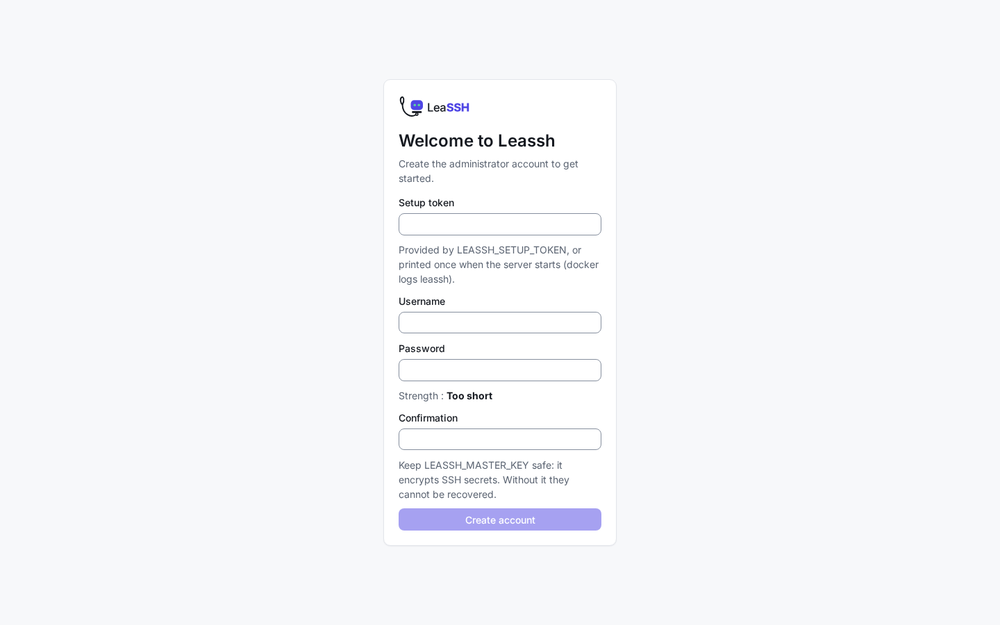
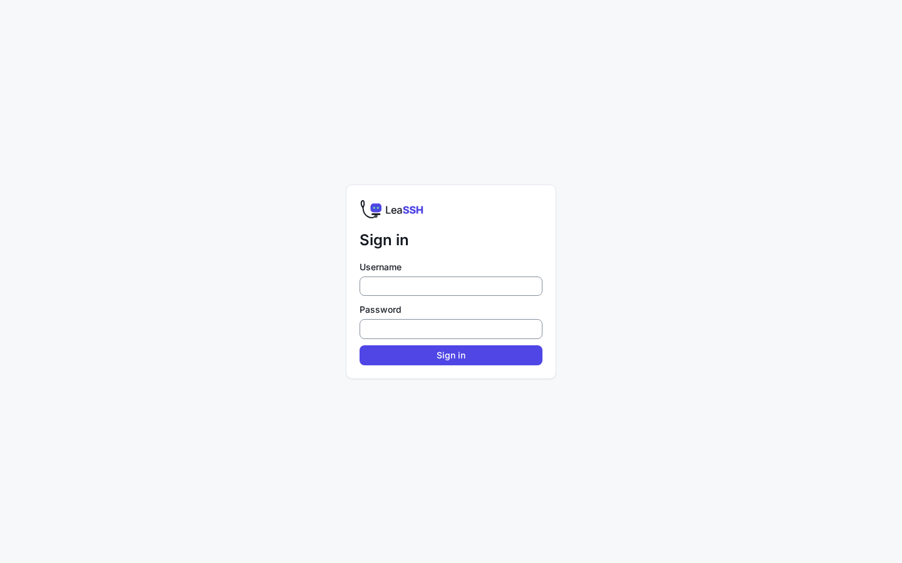

**English** · [Français](../fr/connexion.md)

# Sign-in and setup

**Who**: everyone. **Required role**: none.

## Setup (first launch)

On a fresh instance, Leassh shows *Welcome to Leassh*. Fill in:

- the **setup token** (the `LEASSH_SETUP_TOKEN` variable, or the token printed once in the logs);
- the **username** and **password** (10 characters minimum) with its confirmation.

The account created is an administrator. Once an account exists, this screen is no longer reachable.

## Sign-in

Enter username and password. If **SSO** is enabled, a *Sign in with <provider>* button appears; the administrator can also choose automatic redirection. To show the local fallback form anyway, add `?login` to the address (`https://leassh.example.com/?login`).

## Good to know

- **Attempt limiting**: 5 failures per IP + account pair in 15 minutes (cap of 50 per IP). Counters are stored in the database; a restart does not reset them.
- **Sessions**: configurable lifetime (12 h by default) and expiry after 30 minutes of inactivity.
- **Lost password**: on the machine, `leassh reset-password <username>` (see [Operations](operations.md)).
- **SSO errors**: an `sso_error` message is shown on the page; the exact reason is in the administration log (see [SSO](sso.md)).

---

[← Previous : User manual](user-manual.md) · [Home](README.md) · [Next : Dashboard →](dashboard.md)
