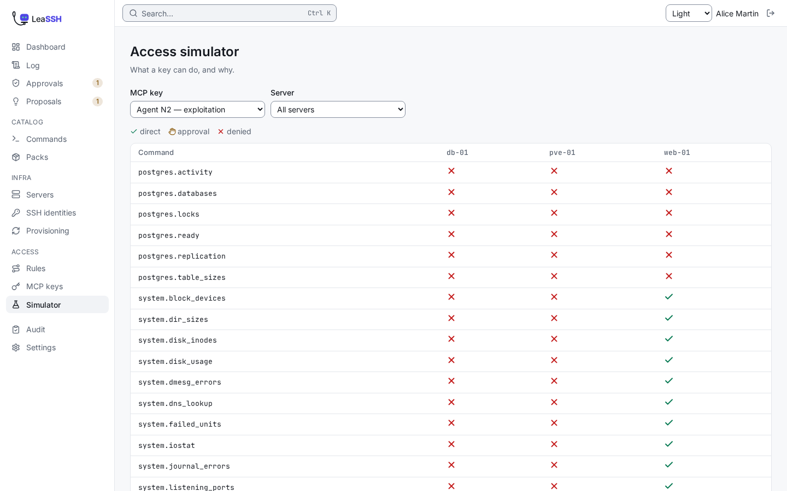

**English** · [Français](../fr/simulateur.md)

# Access simulator

**Who**: all roles. **Path**: `/simulateur`.

The simulator answers: *"what can this key do, and why?"*. It uses **exactly the same evaluation function** as real execution (see [Access rules](access-rules.md)).

## Usage

1. Choose an **MCP key**.
2. Choose a **server**, or *All servers*.
3. The table crosses commands (rows) and servers (columns):

| Symbol | Meaning |
|---|---|
| ✓ **direct** | The command runs without approval |
| ✋ **approval** | Runnable after human approval |
| ✗ **denied** | Not allowed |

For each allowed cell, the **rule** that permits it is shown.

## When to use it

- **Before** handing a key to an agent: check it only covers what you want.
- **To understand a denial**: if an agent receives "server or command unavailable for this key" (deliberately generic), the simulator and the [Log](log.md) give the exact reason.
- **After** changing a rule, group or host key.

## Good to know

- A server whose host key is not pinned appears denied for every command.
- An expired or revoked key is denied everywhere.

---

[← Previous : MCP keys](mcp-keys.md) · [Home](README.md) · [Next : Audit report (ISO 27001, HDS) →](audit.md)
