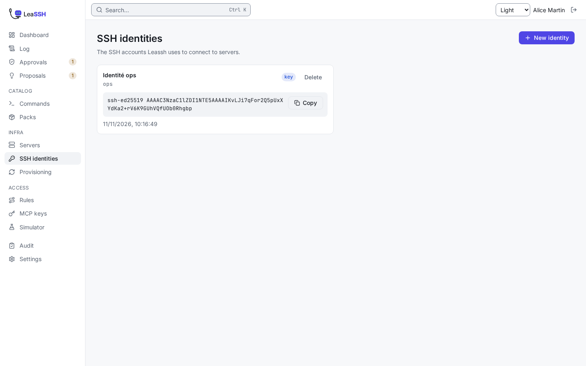

**English** · [Français](../fr/identites-ssh.md)

# SSH identities

**Who**: read for everyone; manage: `admin`. **Path**: `/identites`.

An **SSH identity** is the account (user + secret) Leassh uses to connect to servers. Several servers can share one identity.

## Create an identity

*New identity* offers three modes:

| Mode | Use |
|---|---|
| **Generate an ed25519 key** (recommended) | Leassh creates the pair; the private key is encrypted (AES-256-GCM) and **never leaves** Leassh. The screen shows the public key and the line to add to `authorized_keys`. |
| **Import a private key** | To reuse an existing key. |
| **Password** | Possible but discouraged; the audit report flags it. |

## After creation

- **Copy** the public key and put it in the target user's `~/.ssh/authorized_keys` (ideally with `restrict,from="<Leassh IP>"`).
- Attach the identity to a [server](servers.md).

## Good to know

- The private key is **never** returned by the API nor logged; it is re-encrypted by `leassh rotate-master-key`.
- Without the master key (`LEASSH_MASTER_KEY`), private keys cannot be recovered: see [Operations](operations.md).
- For a Warpgate bastion, the [provisioning](provisioning.md) connector's identity is the one whose public key is declared on the Warpgate user.

---

[← Previous : Servers and server groups](servers.md) · [Home](README.md) · [Next : Provisioning (Warpgate bastion) →](provisioning.md)
