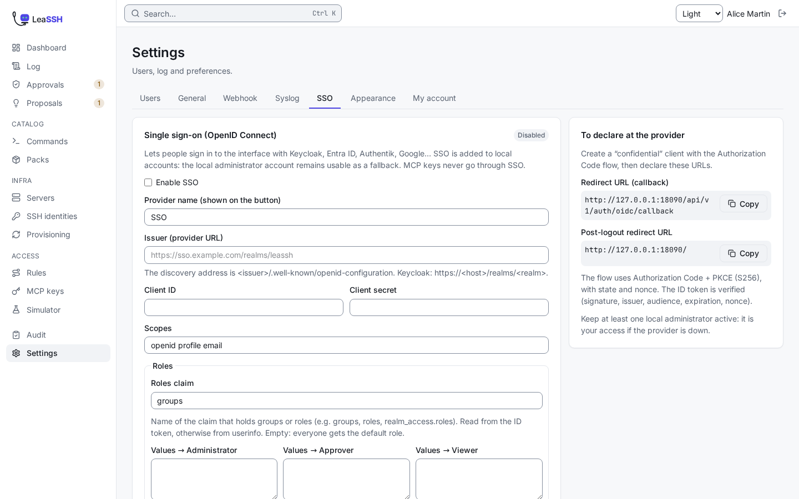
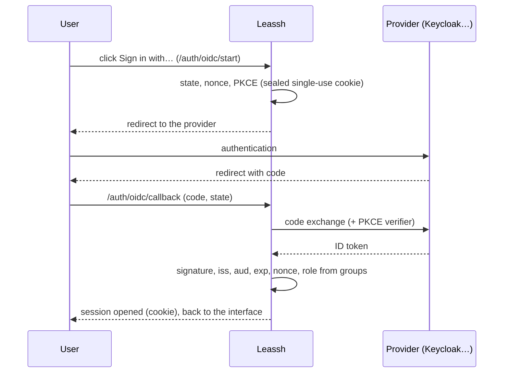

**English** · [Français](../fr/sso.md)

# Single sign-on (OpenID Connect)

**How it works.** Authorization Code + **PKCE S256**, `state` and `nonce`. Leassh verifies the ID token (signature via the provider's JWKS, `iss`, `aud`, `exp`, `nonce`), computes the role from a groups claim, then opens the usual session. Accounts are bound to `(issuer, sub)`, **never to the email**. A single provider; no SCIM. See [ADR 0001](../adr/0001-authentification-sso-et-compte-local.md).

SSO signs users in to the **interface**. The local administrator account created at setup is used for the first sign-in and to configure SSO; once SSO is validated, you can disable the local password (step 8). MCP keys do not go through SSO.

**Before you start**: Leassh must be reachable at the URL your users type (Settings → General → Public URL, e.g. `https://leassh.example.com`). The Leassh server must be able to reach Keycloak (discovery, tokens, JWKS) and both machines' clocks must be correct (NTP; 60 s tolerance).

## Keycloak side

1. Choose the realm (or create one, e.g. `leassh`). The **issuer** will be `https://<keycloak-host>/realms/leassh` (Keycloak ≥ 17; before: `/auth/realms/leassh`).
2. **Clients → Create client**: *Client type* `OpenID Connect`, *Client ID* `leassh`.
3. *Capability config*: **Client authentication = On** (confidential client), *Standard flow* ticked, the rest unticked.
4. *Login settings* — enter the two URLs shown in **Settings → SSO** (right-hand column, Copy button):
   - *Valid redirect URIs*: `https://leassh.example.com/api/v1/auth/oidc/callback` (exactly);
   - *Valid post logout redirect URIs*: `https://leassh.example.com/`;
   - *Web origins* can stay empty.
5. **Advanced → Advanced settings** tab: *Proof Key for Code Exchange Code Challenge Method* = `S256`.
6. **Credentials** tab: copy the *Client secret*.
7. **Groups**: create e.g. `leassh-admins`, `leassh-approvers`, `leassh-readers` and put your users in them.
8. **Map the groups**: *Clients → leassh → Client scopes → leassh-dedicated → Add mapper → By configuration → Group Membership*: *Name* `groups`, *Token Claim Name* `groups`, **Full group path = On** (values `/leassh-admins`) or Off (values `leassh-admins`), *Add to ID token = On*, *Add to userinfo = On*. (To use realm roles instead, the claim is `realm_access.roles`, added to the access token by default: also enable it in the ID token or userinfo via a *User Realm Role* mapper.)

## Leassh side (Settings → SSO)

1. *Provider name*: `Keycloak` (text of the "Sign in with Keycloak" button).
2. *Issuer*: `https://<keycloak-host>/realms/leassh`, then **Test discovery**: you should see the endpoints, the number of signing keys and any warnings (HTTP issuer, no provider logout…).
3. *Client ID* `leassh`, *Client secret* (paste the one from step 6; it is encrypted and never shown again). *Scopes*: `openid profile email` (add `groups` or `roles` if your provider requires it).
4. *Roles*: *Claim* `groups`; one value per line in each column, e.g. `/leassh-admins` → Administrator, `/leassh-approvers` → Approver, `/leassh-readers` → Viewer. The highest role wins. *No match*: "Viewer" or "Refuse sign-in" (recommended in production).
5. *Accounts*: leave "create the account automatically" so each newly authorised person gets an account at first sign-in. Accounts are bound to the provider's `sub`, **never to email or name**: a local account with the same name is not taken over, the SSO account gets a suffixed name.
6. *Reserve the local password for local administrators*: tick once SSO is validated (local admins keep the fallback). *Also end the provider session*: uses the logout URL of step 4.
7. Tick **Enable SSO**, save, then test in a private window while keeping your admin session open. Each sign-in and failure is in the administration log (`user.sso_login`, `user.sso_login_failed` with the reason).
8. *Disable the local password (mandatory SSO)*: once an SSO administrator has signed in successfully, tick this option and save. No local account can sign in with a password anymore, administrator included. If SSO goes down, re-enable local sign-in on the server: `LEASSH_DATA_DIR=/data leassh enable-local-login` (Docker: `docker exec leassh /leassh enable-local-login`).

## Other providers

| Provider | Issuer | Notes |
|---|---|---|
| Entra ID | `https://login.microsoftonline.com/<tenant>/v2.0` | App registration, client secret, *Web* redirect; `groups` claim (group IDs) via *Token configuration* or `roles` via *App roles*. |
| Authentik | `https://<host>/application/o/<slug>/` | OAuth2/OpenID provider, `groups` scope (added to the *profile* mapping). |
| Google | `https://accounts.google.com` | No groups: leave the claim empty and use the default role (or refuse); the admin role is then managed through the local fallback. |

## Common problems

| Symptom (`?sso_error=`) | Probable cause |
|---|---|
| `discovery_failed` | Wrong issuer (trailing slash, extra `/auth`), Keycloak unreachable from Leassh, or the announced `issuer` differs (wrong host name / `KC_HOSTNAME`). |
| `token_exchange_failed` | Wrong client secret, redirect URL not declared identically, PKCE not accepted. |
| `token_expired` / `token_not_yet_valid` | Clocks out of sync. |
| `token_audience` | Client ID mismatch (or missing audience mapper). |
| `role_not_mapped` | The claim is missing from the token (mapper not added to ID token / userinfo) or no value matches (full path `/group` or not). |
| `state_missing` | Cookie lost: return through another browser or address than the one used to start, or link already used. Always use the same URL. |

An `http://` issuer works (local network) but the authorization code and secret travel in clear: prefer HTTPS.

## Audit

Each sign-in and failure is in the [administration log](log.md): `user.sso_login`, `user.sso_login_failed` (with the reason: `state_mismatch`, `token_signature`, `token_audience`, `role_not_mapped`, `not_provisioned`, `account_disabled`…, never a token), `user.create`, `user.update`, `oidc.update`, `oidc.test`.

## Limits

A single provider; no SCIM nor automatic deprovisioning (a user removed from the provider can no longer sign in but keeps their session until it expires: disable their account for immediate effect); no back-channel logout; with automatic creation disabled, only already-linked accounts can sign in.

---

[← Previous : Security model](security.md) · [Home](README.md) · [Next : Operations: update, backup, monitoring →](operations.md)
