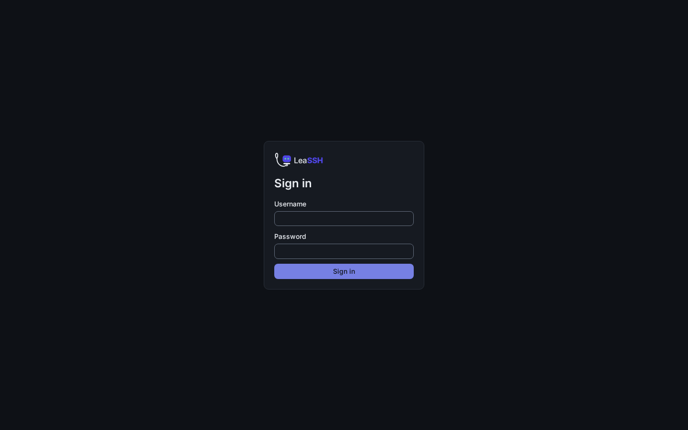

**English** · [Français](../fr/manuel-utilisateur.md)

# User manual

This manual describes the administration interface **screen by screen**. Each page says what the screen is for, who can act on it, what is displayed, common gestures and pitfalls.

## Roles and permissions

| Action | `admin` | `approver` | `viewer` |
|---|---|---|---|
| Read configuration and logs | ✅ | ✅ | ✅ |
| Approve or reject an execution | ✅ | ✅ | ❌ |
| Approve a proposal, change configuration | ✅ | ❌ | ❌ |
| Test a command from the editor | ✅ | ❌ | ❌ |

Permissions are **always checked on the server**: a hidden button is only a convenience.

## Navigation

The sidebar groups the screens:

| Section | Screens |
|---|---|
| (top) | [Dashboard](dashboard.md), [Log](log.md), [Approvals](approvals.md), [Proposals](proposals.md) |
| Catalog | [Commands](commands.md), [Packs](packs.md) |
| Infra | [Servers](servers.md), [SSH identities](ssh-identities.md), [Provisioning](provisioning.md) |
| Access | [Rules](access-rules.md), [MCP keys](mcp-keys.md), [Simulator](simulator.md) |
| (bottom) | [Audit](audit.md), [Settings](settings.md) |

At the top: the **search palette** (`Ctrl K`, or `⌘K`) to jump to a screen or a resource, the **theme** selector (System, Light, Dark), your name and sign-out. The sidebar badges count pending approvals and proposals.

An example of the dark theme:

The **Approvals** and **Log** screens are designed to work on mobile (narrow screens).

---

[← Previous : Getting started](getting-started.md) · [Home](README.md) · [Next : Sign-in and setup →](sign-in.md)
