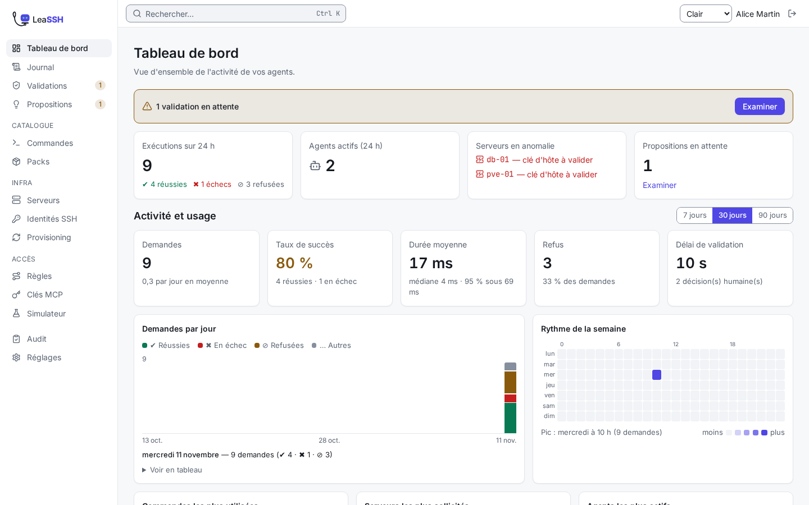

**Français** · [English](../en/README.md)

# Documentation de Leassh

> **Donnez à vos agents IA un accès SSH… en laisse.** Un catalogue de commandes validées, des droits clairs, et un journal de tout ce qui a été lancé, par qui et où.

Leassh est un serveur **MCP** open source qui donne à des agents d'IA un accès SSH **limité à un catalogue de commandes validées** : pas de shell, des paramètres typés, une validation humaine des actions sensibles et un journal complet.

## Par où commencer ?

| Je veux… | Page |
|---|---|
| Comprendre à quoi sert Leassh | [Présentation et concepts](presentation.md) |
| L'installer (Docker, binaire, reverse proxy) | [Installation](installation.md) |
| Aller de l'installation à la première exécution | [Premiers pas](premiers-pas.md) |
| Utiliser l'interface écran par écran | [Manuel utilisateur](manuel-utilisateur.md) |
| Connecter un agent IA | [Agents et outils MCP](agents-mcp.md) |
| Comprendre le modèle de sécurité | [Sécurité](securite.md) |
| Brancher mon SSO (Keycloak…) | [SSO](sso.md) |
| Sauvegarder, mettre à jour, superviser | [Exploitation](../exploitation.md) |
| Appeler l'API | [Référence de l'API](api.md) |
| Résoudre un problème | [Dépannage et FAQ](depannage.md) |
| Contribuer au code | [Contribuer](contribuer.md) |

## En une image

## Parcours conseillé

1. Lisez la [présentation](presentation.md) (10 minutes).
2. Suivez l'[installation](installation.md) puis les [premiers pas](premiers-pas.md).
3. Parcourez le [manuel](manuel-utilisateur.md) selon vos besoins.
4. Avant la mise en production : [sécurité](securite.md) et [exploitation](../exploitation.md).

Code source et tickets : [dépôt GitHub](https://github.com/sebdew/LeaSSH). Licence Apache 2.0.

## Toutes les pages

**Démarrer**

- [Présentation et concepts](presentation.md)
- [Installation](installation.md)
- [Premiers pas](premiers-pas.md)

**Manuel utilisateur**

- [Manuel utilisateur](manuel-utilisateur.md)
  - [Connexion et initialisation](connexion.md)
  - [Tableau de bord](tableau-de-bord.md)
  - [Journal](journal.md)
  - [Validations](validations.md)
  - [Propositions](propositions.md)
  - [Serveurs et groupes de serveurs](serveurs.md)
  - [Identités SSH](identites-ssh.md)
  - [Provisioning (bastion Warpgate)](provisioning.md)
  - [Commandes et groupes de commandes](commandes.md)
  - [Packs de commandes](packs.md)
  - [Règles d'accès](regles-d-acces.md)
  - [Clés MCP](cles-mcp.md)
  - [Simulateur d'accès](simulateur.md)
  - [Rapport d'audit (ISO 27001, HDS)](audit.md)
  - [Réglages](reglages.md)

**Référence et exploitation**

- [Agents et outils MCP](agents-mcp.md)
- [Modèle de sécurité](securite.md)
- [Connexion unique (SSO, OpenID Connect)](sso.md)
- [Exploitation : mise à jour, sauvegarde, supervision](../exploitation.md)
- [Architecture](../architecture.md)
- [Référence de l'API](api.md)
- [Dépannage et FAQ](depannage.md)
- [Structure du dépôt et décisions](structure-du-depot.md)
- [Contribuer et développer](contribuer.md)
