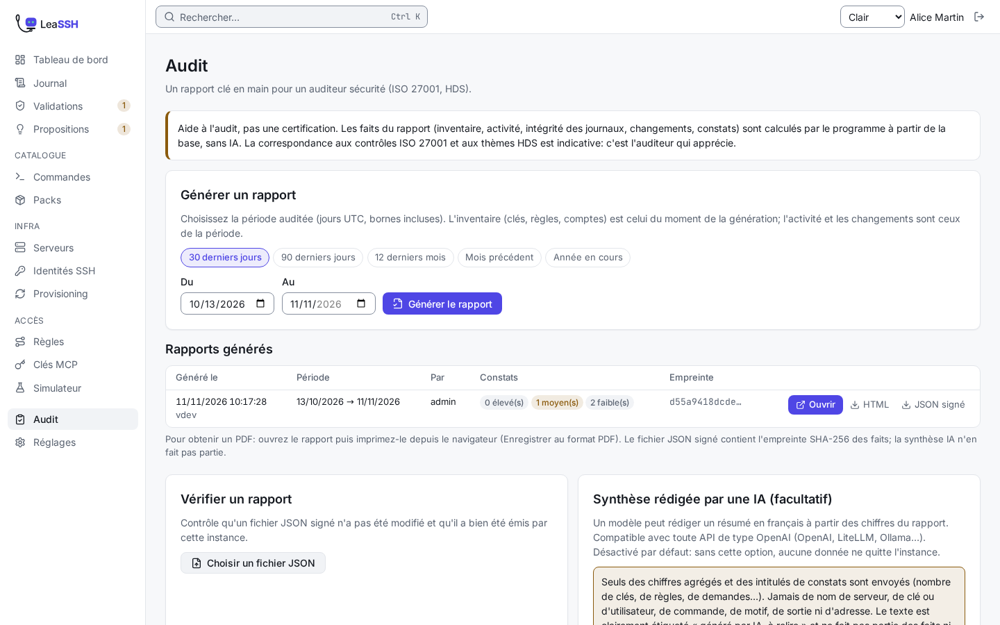

**Français** · [English](../en/audit.md)

# Rapport d'audit (ISO 27001, HDS)

**Qui** : `admin`. **Chemin** : `/audit`.

Cet écran produit en quelques clics un **rapport clé en main pour un auditeur** sécurité. C'est une **aide à l'audit, pas une certification** : la correspondance aux contrôles est indicative, c'est l'auditeur qui apprécie.

## Générer un rapport

Choisissez la période (*30 derniers jours*, *90 derniers jours*, *12 derniers mois*, *mois précédent*, *année en cours*, ou des dates *Du / Au* en UTC, bornes incluses, 400 jours maximum), puis **Générer**. L'inventaire (clés, règles, comptes) est celui du **moment de la génération** ; l'activité et les changements sont ceux de la **période**.

## Contenu du rapport

- **Configuration** : rétention, expiration des validations, HTTPS, webhook ;
- **Périmètre** : serveurs, groupes, commandes par risque et origine, clés MCP (état, expiration, dernière utilisation), règles RO/RW avec ou sans validation, comptes, identités, connecteurs ;
- **Activité** : issues, refus par cause, validations humaines (délai, décideur), écritures sans validation, demandes destructives détaillées, événements de sécurité ;
- **Intégrité** : vérification complète des deux chaînes de hash, plage de séquences, **tête de chaîne**, rétention, purges ;
- **Changements d'administration** (1 000 listés au maximum, totaux exacts) ;
- **Constats** automatiques avec gravité (élevée, moyenne, faible, information) : règle RW sans validation, clés sans expiration ou inutilisées depuis 90 jours, admin inactif, serveur sans clé d'hôte épinglée, rupture d'intégrité, rétention inférieure à 365 jours, interface sans HTTPS, pas de webhook, un seul administrateur, identités par mot de passe, échecs de synchronisation… Les seuils sont **indicatifs** ;
- **Correspondance** à 14 contrôles de l'annexe A de l'ISO/IEC 27001:2022 et à 4 thèmes HDS (traçabilité, habilitations, conservation, cloisonnement, sans numéro de clause). Statuts : « éléments de preuve », « points mineurs », « points d'attention » — **jamais un verdict de conformité**.

Les **faits** sont calculés de façon déterministe à partir de la base, **sans IA** : deux calculs du même état donnent le même JSON à l'octet près.

## Exporter et remettre à l'auditeur

- **Ouvrir** : page HTML autonome (aucun script ni ressource externe), imprimable en PDF depuis le navigateur ;
- **JSON signé** : `{format: "leassh-audit-report/1", signature, snapshot}`. `signature.digest` est le SHA-256 du JSON compact de `snapshot` : l'auditeur le recalcule avec `jq -cj .snapshot rapport.json | sha256sum`. `signature.tag` est un HMAC dérivé de la clé maître : seule votre instance peut le recalculer ;
- **Vérifier un rapport** : déposez le fichier ; Leassh répond `digest_ok` et `tag_ok` (le fichier vient bien de votre instance) ;
- remettez aussi la **tête de chaîne** des journaux figurant dans le rapport : elle permet de détecter une troncature ultérieure.

## Synthèse rédigée par une IA (facultatif)

Désactivée par défaut. Dans l'écran (ou par les variables `LLM_BASE_URL`, `LLM_MODEL`, `LLM_API_KEY` comme valeurs par défaut) : URL d'une **API compatible OpenAI** (OpenAI, LiteLLM, Ollama…), modèle et clé (chiffrée, jamais renvoyée).

- **Confidentialité** : seuls des **chiffres agrégés et des intitulés fixes** sont envoyés (nombre de clés, de règles, de demandes, constats). Jamais de nom de serveur, de clé, d'utilisateur ou de commande, jamais de motif, de sortie ni d'adresse. Si l'URL est externe, ces chiffres **quittent votre réseau**.
- Le texte est étiqueté « générée par IA, à relire », stocké **hors de l'empreinte** du rapport, dans la langue choisie, et n'est pas retraduit ensuite.

## À savoir

- Les rapports **ne se suppriment pas** ; chaque génération est dans le journal d'administration.
- La rétention des journaux (365 jours par défaut) limite la période auditable.
- Le contenu du rapport (faits, intitulés) n'est pas traduit.

---

[← Précédent : Simulateur d'accès](simulateur.md) · [Accueil](README.md) · [Suivant : Réglages →](reglages.md)
