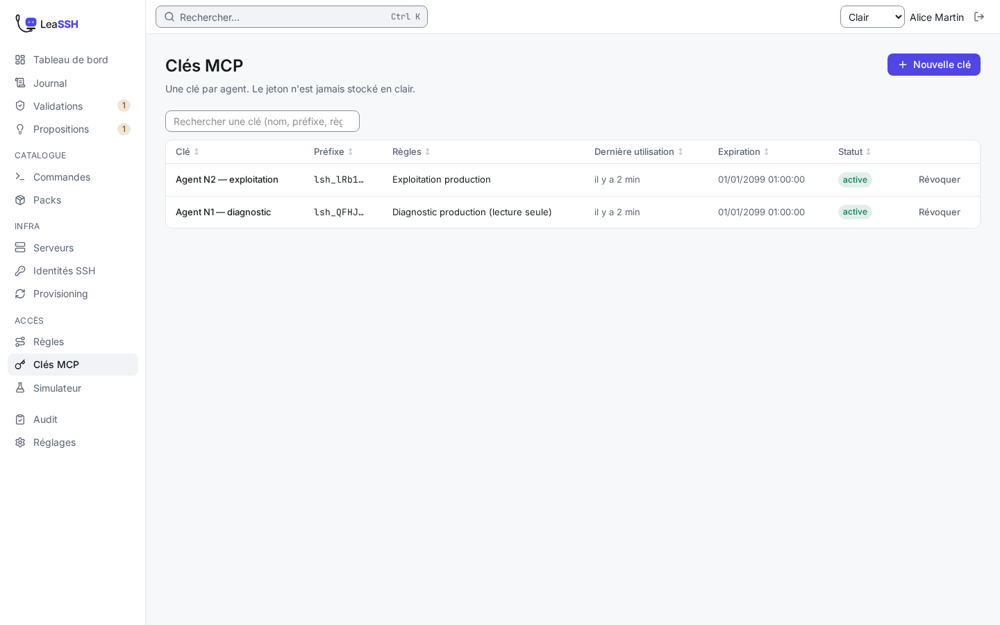
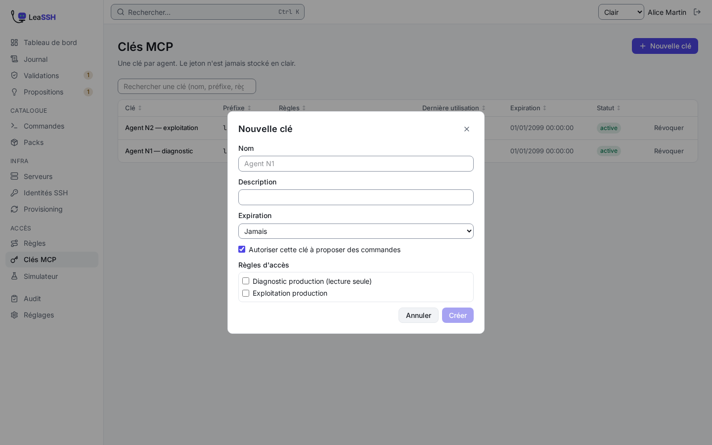

**Français** · [English](../en/mcp-keys.md)

# Clés MCP

**Qui** : lecture pour tous ; gestion : `admin`. **Chemin** : `/cles`.

Une **clé MCP** est l'identité d'un agent : « une clé par agent ». Colonnes : nom, **préfixe** (`lsh_QFHJ…`), règles rattachées, dernière utilisation, expiration, statut (*active*, *expirée*, *révoquée*) et l'action *Révoquer*.

## Créer une clé

*Nouvelle clé* : nom, description, **expiration** (recommandée), option **peut proposer** (autorise l'outil `propose_command`) et règles rattachées.

> **Le jeton (`lsh_…`) n'est affiché qu'une seule fois**, à la création. Copiez-le tout de suite : Leassh n'en conserve que l'empreinte (hash), comparée à temps constant. Il ne pourra plus jamais être relu.

## Utiliser la clé

Dans la configuration MCP de l'agent, en-tête `Authorization: Bearer lsh_…` (voir [Agents et outils MCP](agents-mcp.md)).

## Révoquer, expirer, désactiver

- *Révoquer* : la clé n'a plus aucun droit. Le jeton reste reconnu pour journaliser les tentatives (`key_inactive`, `key_expired`) mais ne permet plus rien.
- Une clé expirée est traitée de même.
- Une clé qui échoue à s'authentifier produit un événement `key.auth_failed` (préfixe seulement).

## Limites et sécurité

- **60 appels d'outils par minute et par clé** (fenêtre glissante) ; au-delà, HTTP 429 avec `Retry-After`. La poignée de main du protocole n'est pas comptée.
- Une clé ne peut **rien modifier** : ni configuration, ni validation, ni lecture des exécutions d'une autre clé.
- Les clés MCP ne passent jamais par le SSO.

## À savoir

- Donnez à chaque agent sa propre clé : le journal et le simulateur permettent alors de tout attribuer.
- Réalisez une rotation en créant une nouvelle clé, en la déployant, puis en révoquant l'ancienne.

---

[← Précédent : Règles d'accès](regles-d-acces.md) · [Accueil](README.md) · [Suivant : Simulateur d'accès →](simulateur.md)
