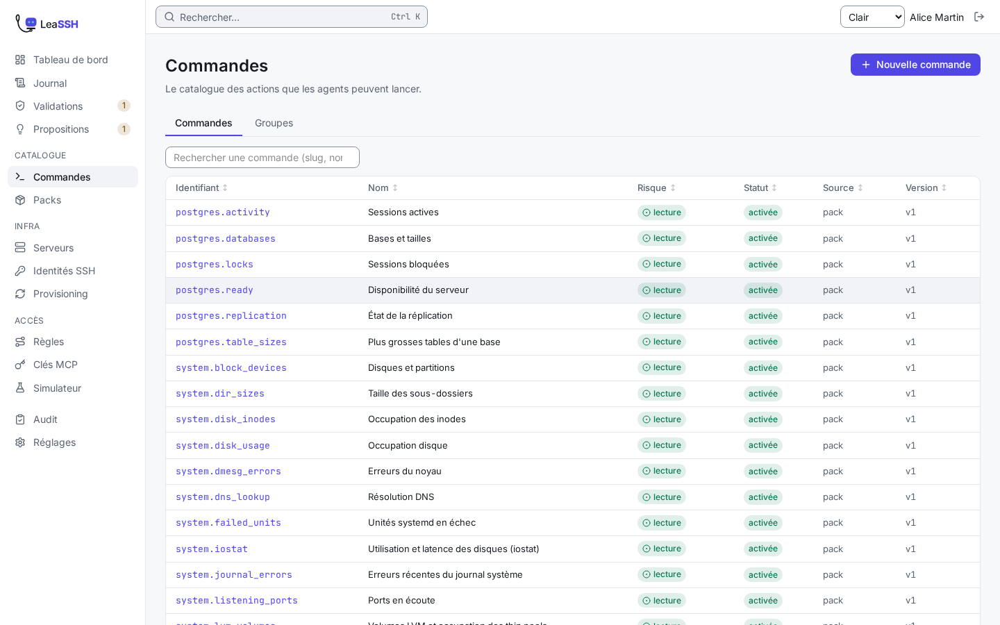
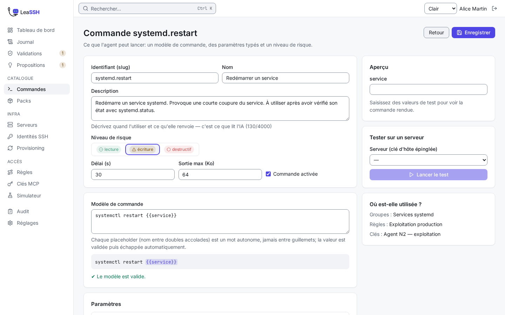

**Français** · [English](../en/commands.md)

# Commandes et groupes de commandes

**Qui** : lecture pour tous ; création, modification, test : `admin`. **Chemin** : `/commandes` (onglets *Commandes* et *Groupes*).



Le **catalogue** est la liste blanche de tout ce que les agents peuvent lancer. Colonnes : identifiant, nom, risque (lecture, écriture, destructive), statut (activée ou non), source (`pack`, `manual`, `proposal`) et version. Chaque modification incrémente la version et change l'empreinte (hash) de la commande.

## L'éditeur de commande



- **Identifiant (slug)** et **nom** ;
- **Description** : lue par l'IA. Écrivez *quand l'utiliser* et *ce qu'elle renvoie* (jusqu'à 4 000 caractères) ;
- **Niveau de risque** : lecture, écriture ou destructif ([signification](presentation.md)) ;
- **Délai** (secondes) : à expiration, signal puis fermeture du canal, statut `timeout` ;
- **Sortie max** (Ko) : au-delà, la sortie est tronquée (indicateur `truncated`) ;
- **Commande activée** : une commande désactivée n'est plus lançable ;
- **Modèle de commande** avec ses placeholders `{{nom}}`, validé en direct (« ✔ Le modèle est valide ») ;
- **Paramètres** typés, un par placeholder ;
- à droite : **Aperçu** (saisissez des valeurs de test pour voir la commande rendue), **Tester sur un serveur** (serveur à clé d'hôte épinglée ; produit une exécution journalisée avec `actor = user`, sans règle d'accès ni validation) et **Où est-elle utilisée ?** (groupes, règles, clés).

### Règles d'écriture d'un modèle

- Un placeholder est un **mot autonome**, jamais entre guillemets : ✅ `journalctl -u {{service}}` ✅ `--unit={{service}}` ❌ `echo "{{x}}"` ❌ `/var/log/{{name}}.log` (utilisez un paramètre `path`).
- Tous les placeholders sont déclarés, et tous les paramètres sont utilisés.
- Les métacaractères shell (`;`, `&`, `|`, `>`, `<`, `$(`, backtick) sont des **avertissements** pour un administrateur et des **erreurs** pour une proposition. Les erreurs de *structure* (placeholder entre guillemets, collé à du texte, premier mot placeholder, non déclaré) bloquent toujours, car elles garantissent la sûreté de l'échappement.

### Types de paramètres

| Type | Validation | Options |
|---|---|---|
| `enum` | valeur parmi une liste | `values` (obligatoire) |
| `int` | entier dans des bornes | `min`, `max` (obligatoires) |
| `identifier` | `^[A-Za-z0-9._@-]{1,64}$`, ne commence pas par `-` | `max_length` |
| `service` | `^[A-Za-z0-9@._:-]{1,128}$`, ne commence pas par `-` | |
| `path` | absolu, normalisé, sans `..`, préfixé par un des préfixes autorisés | `allowed_prefixes` (obligatoire) |
| `regex` | correspond au motif (ancré automatiquement), ne commence pas par `-` | `pattern`, `max_length` |

Communs : `description` (lue par l'IA), `required` (vrai par défaut), `default`. **Il n'existe aucun type « texte libre ».** À l'exécution, la valeur est validée puis insérée **échappée** (guillemets simples, `'` devient `'\''`).

### Exemple

```yaml
- id: systemd.restart
  name: Redémarrer un service
  description: >
    Redémarre un service systemd. Provoque une coupure de quelques secondes.
    À utiliser après avoir vérifié l'état avec systemd.status.
  risk: write
  template: systemctl restart {{service}}
  params:
    service: { type: service, description: "Nom de l'unité systemd" }
```

## Groupes de commandes

L'onglet **Groupes** regroupe des commandes (souvent créé à l'import d'un [pack](packs.md)). Un groupe est rattaché aux [règles d'accès](regles-d-acces.md).

## À savoir

- Une commande sans groupe, ou dont le groupe n'est dans aucune règle, n'est lançable par personne.
- Les administrateurs peuvent écrire des commandes avec pipe (`ps aux | sort`) : un avertissement s'affiche, une proposition d'agent est refusée.
- Le **test** depuis l'éditeur exécute vraiment la commande sur le serveur choisi.

---

[← Précédent : Provisioning (bastion Warpgate)](provisioning.md) · [Accueil](README.md) · [Suivant : Packs de commandes →](packs.md)
