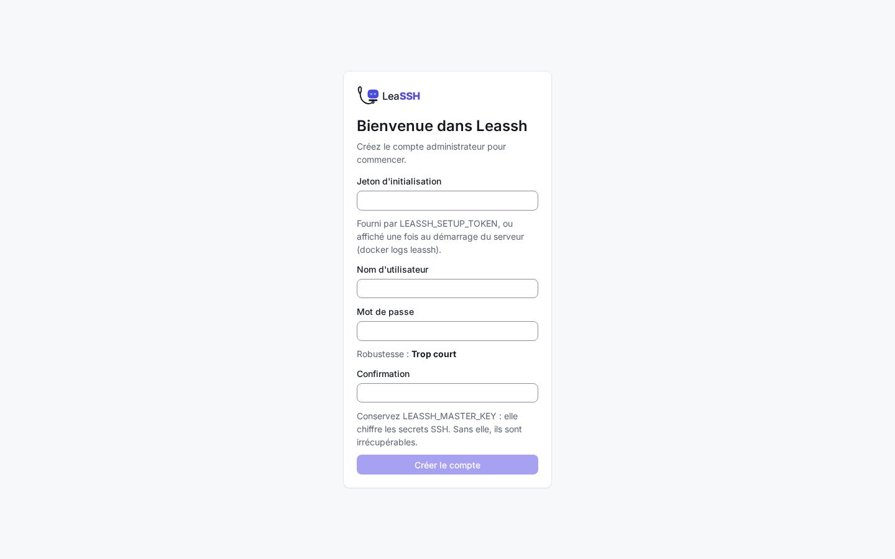
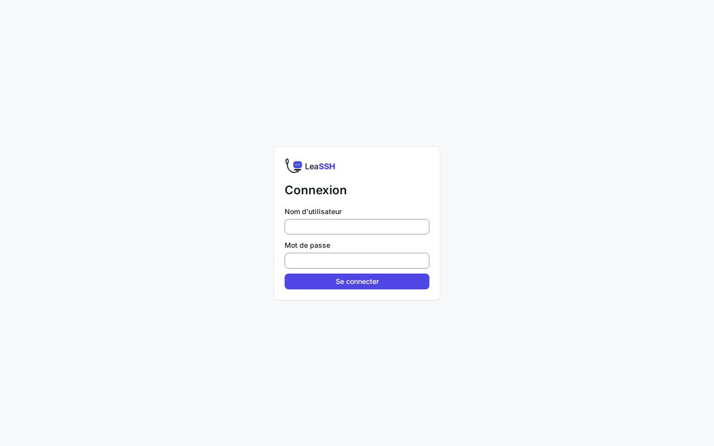

**Français** · [English](../en/sign-in.md)

# Connexion et initialisation

**Qui** : tout le monde. **Rôle requis** : aucun.

## Initialisation (premier lancement)

Sur une instance neuve, Leassh affiche *Bienvenue dans Leassh*. Renseignez :

- le **jeton d'initialisation** (variable `LEASSH_SETUP_TOKEN`, ou jeton affiché une fois dans les logs) ;
- le **nom d'utilisateur** et le **mot de passe** (10 caractères minimum) avec sa confirmation.

Le compte créé est administrateur. Une fois un compte créé, cet écran n'est plus accessible.

## Connexion

Saisissez nom d'utilisateur et mot de passe. Si le **SSO** est activé, un bouton *Se connecter avec <fournisseur>* apparaît ; l'administrateur peut aussi choisir une redirection automatique. Pour afficher quand même le formulaire local de secours, ajoutez `?login` à l'adresse (`https://leassh.example.com/?login`).

## Bon à savoir

- **Limitation des essais** : 5 échecs par couple IP + compte en 15 minutes (plafond de 50 par IP). Les compteurs sont conservés en base, un redémarrage ne les remet pas à zéro.
- **Sessions** : durée réglable (12 h par défaut) et expiration après 30 minutes d'inactivité.
- **Mot de passe perdu** : sur la machine, `leassh reset-password <identifiant>` (voir [Exploitation](../exploitation.md)).
- **Erreurs SSO** : un message `sso_error` est affiché sur la page ; le motif exact est dans le journal d'administration (voir [SSO](sso.md)).

---

[← Précédent : Manuel utilisateur](manuel-utilisateur.md) · [Accueil](README.md) · [Suivant : Tableau de bord →](tableau-de-bord.md)
