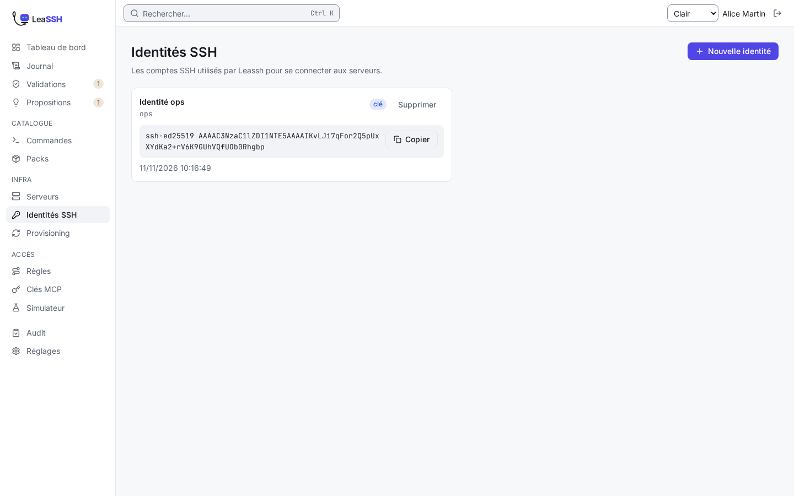

**Français** · [English](../en/ssh-identities.md)

# Identités SSH

**Qui** : lecture pour tous ; gestion : `admin`. **Chemin** : `/identites`.

Une **identité SSH** est le compte (utilisateur + secret) que Leassh utilise pour se connecter aux serveurs. Plusieurs serveurs peuvent partager une identité.

## Créer une identité

*Nouvelle identité* propose trois modes :

| Mode | Usage |
|---|---|
| **Générer une clé ed25519** (recommandé) | Leassh crée la paire ; la clé privée est chiffrée (AES-256-GCM) et **ne sort jamais** de Leassh. L'écran affiche la clé publique et la ligne à ajouter à `authorized_keys`. |
| **Importer une clé privée** | Pour réutiliser une clé existante. |
| **Mot de passe** | Possible mais déconseillé ; le rapport d'audit le signale. |

## Après la création

- **Copier** la clé publique et la placer dans `~/.ssh/authorized_keys` de l'utilisateur cible (idéalement avec `restrict,from="<IP de Leassh>"`).
- Rattacher l'identité à un [serveur](serveurs.md).

## À savoir

- La clé privée n'est **jamais** renvoyée par l'API ni journalisée ; elle est réécrite par `leassh rotate-master-key`.
- Sans la clé maître (`LEASSH_MASTER_KEY`), les clés privées sont irrécupérables : voir [Exploitation](../exploitation.md).
- Pour un bastion Warpgate, l'identité du connecteur de [provisioning](provisioning.md) est celle dont la clé publique est déclarée sur l'utilisateur Warpgate.

---

[← Précédent : Serveurs et groupes de serveurs](serveurs.md) · [Accueil](README.md) · [Suivant : Provisioning (bastion Warpgate) →](provisioning.md)
