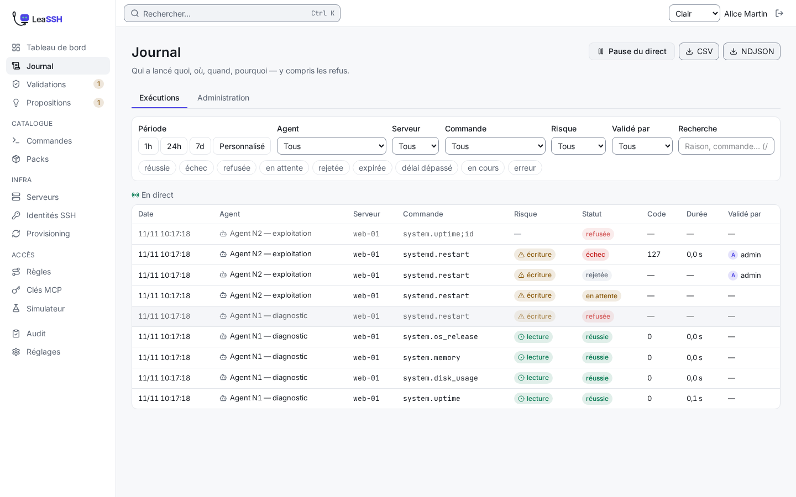
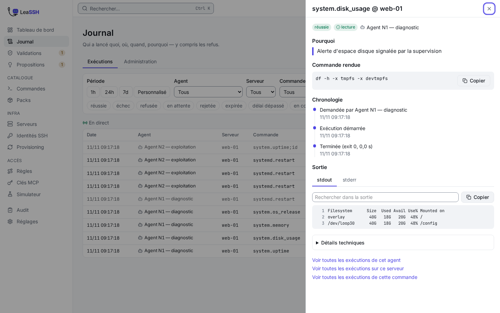
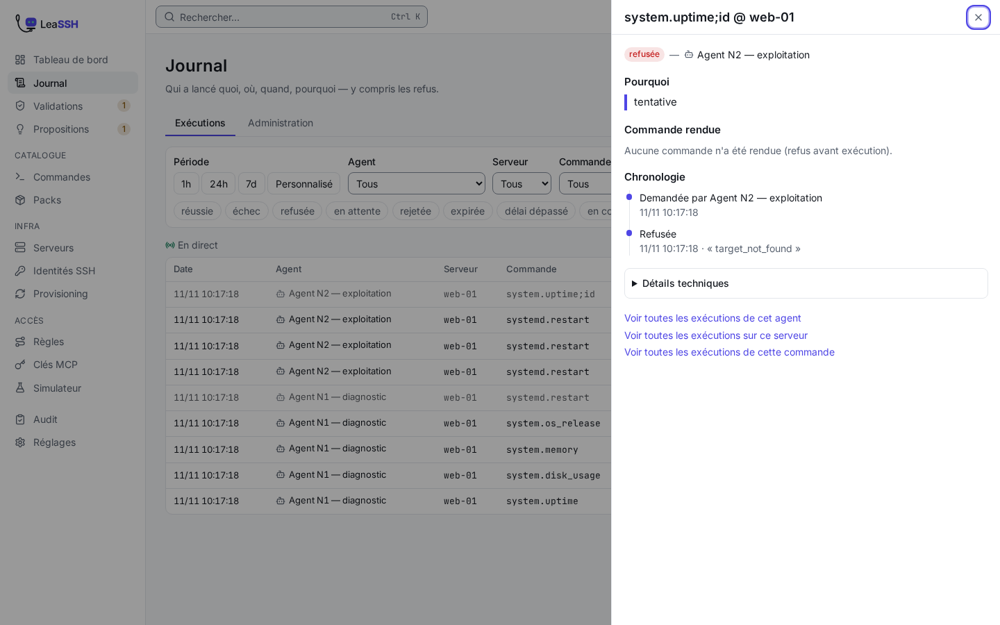
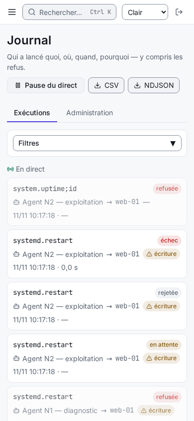

**Français** · [English](../en/log.md)

# Journal

**Qui** : tous les rôles (lecture). **Chemin** : `/journal`. L'écran répond à : *qui a lancé quoi, où, quand, pourquoi, avec quel résultat, et qui l'a validé ?*

## Deux onglets

- **Exécutions** : chaque appel `run_command`, **y compris les refus** (paramètre invalide, serveur non autorisé, clé expirée…).
- **Administration** : chaque modification de configuration, connexion réussie ou échouée, et chaque action sensible, avec un **diff avant/après** (secrets masqués).

## Filtres

Période (1 h, 24 h, 7 j, personnalisée), agent, serveur, commande, statut (réussie, échec, refusée, en attente, rejetée, expirée, délai dépassé, en cours), risque, validateur et recherche texte (motif, commande rendue). Les filtres sont **dans l'adresse** de la page : vous pouvez partager un lien filtré.

## Direct, export

- **En direct** : le journal se met à jour seul (Server-Sent Events). *Pause du direct* fige l'affichage. Derrière un reverse proxy, la mise en mémoire tampon doit être désactivée pour `/api/v1/executions/stream` (voir [Installation](installation.md)).
- **CSV** et **NDJSON** : exportent le résultat filtré. Le CSV neutralise les formules de tableur et n'inclut pas les sorties de commandes.

## Le tiroir de détail

Cliquez une ligne pour ouvrir le détail :

- **Pourquoi** : le motif donné par l'agent ;
- **Commande rendue** : la ligne exacte envoyée au serveur (paramètres validés et échappés) ;
- **Chronologie** : demandée, validée ou refusée (par qui, avec quel commentaire), exécutée ;
- **Sortie** (stdout et stderr, tronquées à la taille maximale de la commande) et code retour, durée ;
- **Détails techniques** : règle qui a autorisé, version et empreinte de la commande, adresse IP du client, identifiant de session MCP, User-Agent, identifiant de l'exécution ;
- liens *Voir toutes les exécutions de cet agent / sur ce serveur / de cette commande*.

Une exécution refusée montre la raison du refus (ex. `target_not_found`, `param_invalid:service`, `key_expired`) :

## Mobile

## À savoir

- Les journaux **ne sont pas modifiables** depuis l'interface. Seule la **rétention automatique** les purge (365 jours par défaut, réglable dans [Réglages → Général](reglages.md)).
- Les appels `list_servers`, `list_commands` et `get_execution` ne créent pas de ligne (pour éviter le bruit) mais mettent à jour la « dernière utilisation » de la clé.
- L'intégrité se vérifie dans **Réglages → Général → Vérifier l'intégrité**.

---

[← Précédent : Tableau de bord](tableau-de-bord.md) · [Accueil](README.md) · [Suivant : Validations →](validations.md)
