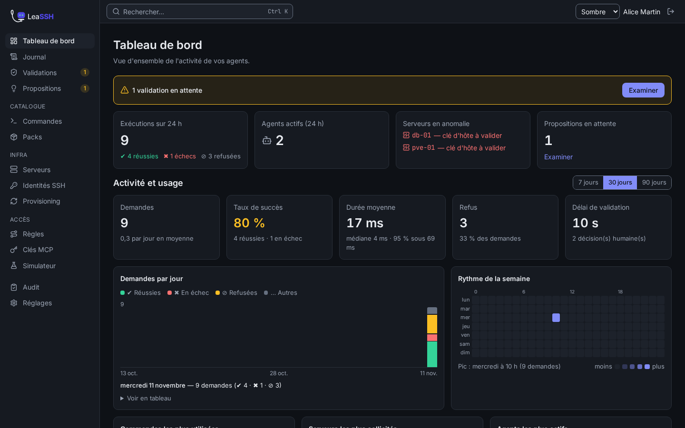

**Français** · [English](../en/user-manual.md)

# Manuel utilisateur

Ce manuel décrit l'interface d'administration **écran par écran**. Chaque page indique à quoi sert l'écran, qui peut y agir, les éléments affichés, les gestes courants et les pièges.

## Rôles et droits

| Action | `admin` | `approver` | `viewer` |
|---|---|---|---|
| Lire la configuration et les journaux | ✅ | ✅ | ✅ |
| Approuver ou refuser une exécution | ✅ | ✅ | ❌ |
| Approuver une proposition, modifier la configuration | ✅ | ❌ | ❌ |
| Tester une commande depuis l'éditeur | ✅ | ❌ | ❌ |

Les droits sont **toujours vérifiés côté serveur** : un bouton masqué n'est qu'un confort.

## Navigation

La barre latérale regroupe les écrans :

| Section | Écrans |
|---|---|
| (haut) | [Tableau de bord](tableau-de-bord.md), [Journal](journal.md), [Validations](validations.md), [Propositions](propositions.md) |
| Catalogue | [Commandes](commandes.md), [Packs](packs.md) |
| Infra | [Serveurs](serveurs.md), [Identités SSH](identites-ssh.md), [Provisioning](provisioning.md) |
| Accès | [Règles](regles-d-acces.md), [Clés MCP](cles-mcp.md), [Simulateur](simulateur.md) |
| (bas) | [Audit](audit.md), [Réglages](reglages.md) |

En haut : la **palette de recherche** (`Ctrl K`, ou `⌘K`) pour aller à un écran ou une ressource, le sélecteur de **thème** (Système, Clair, Sombre), votre nom et la déconnexion. Les pastilles de la barre latérale comptent les validations et propositions en attente.

Un exemple de thème sombre et d'affichage mobile :

Les écrans **Validations** et **Journal** sont conçus pour fonctionner sur mobile (largeur d'écran étroite).

---

[← Précédent : Premiers pas](premiers-pas.md) · [Accueil](README.md) · [Suivant : Connexion et initialisation →](connexion.md)
