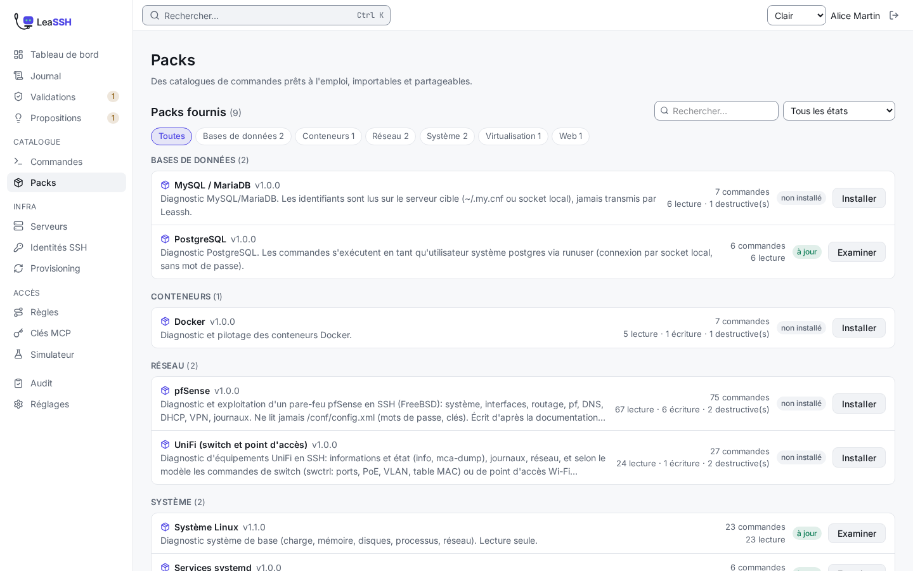

**Français** · [English](../en/packs.md)

# Packs de commandes

**Qui** : lecture pour tous ; installation et export : `admin`. **Chemin** : `/packs`.



Un **pack** est un catalogue de commandes au format YAML, importable et partageable. Neuf packs sont fournis dans le binaire :

| Catégorie | Packs |
|---|---|
| Système | `system`, `systemd` |
| Bases de données | `mysql`, `postgres` |
| Web | `nginx` |
| Conteneurs | `docker` |
| Réseau | `pfsense` (75 commandes), `unifi` (27 : switch et point d'accès) |
| Virtualisation | `proxmox` (60 commandes) |

## L'écran

Recherche (nom, description, identifiants de commandes), filtres par **catégorie** et par **état** (*non installé*, *à jour*, *mise à jour disponible*), une ligne par pack avec le nombre de commandes, la répartition lecture / écriture / destructive et l'état.

## Installer un pack

1. **Installer** : un **aperçu** liste les commandes *nouvelles*, *modifiées* (avec le diff) et *inchangées*. Rien n'est modifié à ce stade.
2. Cochez **créer le groupe de commandes** du nom du pack.
3. Validez : l'import est **atomique** (tout ou rien).

Une commande déjà présente et modifiée par le pack est mise à jour (version incrémentée, source `pack`) en conservant son état activé ou non. Un pack fourni est de confiance ; un fichier importé doit faire accepter explicitement les avertissements du linter. Une **erreur** de linter bloque toujours l'import.

## Importer ou exporter un fichier

L'import accepte un fichier YAML ; l'export produit un pack depuis un groupe, une sélection ou tout le catalogue.

```yaml
pack:
  id: system
  name: Système Linux
  version: 1.0.0
  description: Diagnostic système de base
  category: Système        # facultatif
commands:
  - id: system.disk_usage
    name: Occupation disque
    description: …
    risk: read
    template: df -h -x tmpfs -x devtmpfs
    params: {}
```

## Précautions sur les packs réseau et virtualisation

- Aucun pack ne lit de secret (`/conf/config.xml` pfSense, `/etc/pve/priv`, configuration UniFi).
- Les actions qui coupent du trafic ou des données (`qm stop`, `pct stop`, rollback ou suppression de snapshot, `pfctl -F states`, redémarrages, `set-inform`) sont `destructive` : validation toujours humaine.
- **Ces packs n'ont pas été exécutés sur du matériel réel** : ils sont validés par le linter et l'import ; une commande absente d'un firmware échoue sans effet.
- **pfSense** : le compte SSH doit accepter les commandes (root ou shell `/bin/sh` ; l'utilisateur `admin` par défaut ouvre le menu de la console). **Proxmox** : un serveur par nœud, compte `root@pam` ou avec les droits `qm`, `pct`, `pvesh`. **UniFi** : activez le SSH dans les paramètres d'appareil du contrôleur.

Après l'import, ajoutez le groupe de commandes à une [règle d'accès](regles-d-acces.md).

---

[← Précédent : Commandes et groupes de commandes](commandes.md) · [Accueil](README.md) · [Suivant : Règles d'accès →](regles-d-acces.md)
