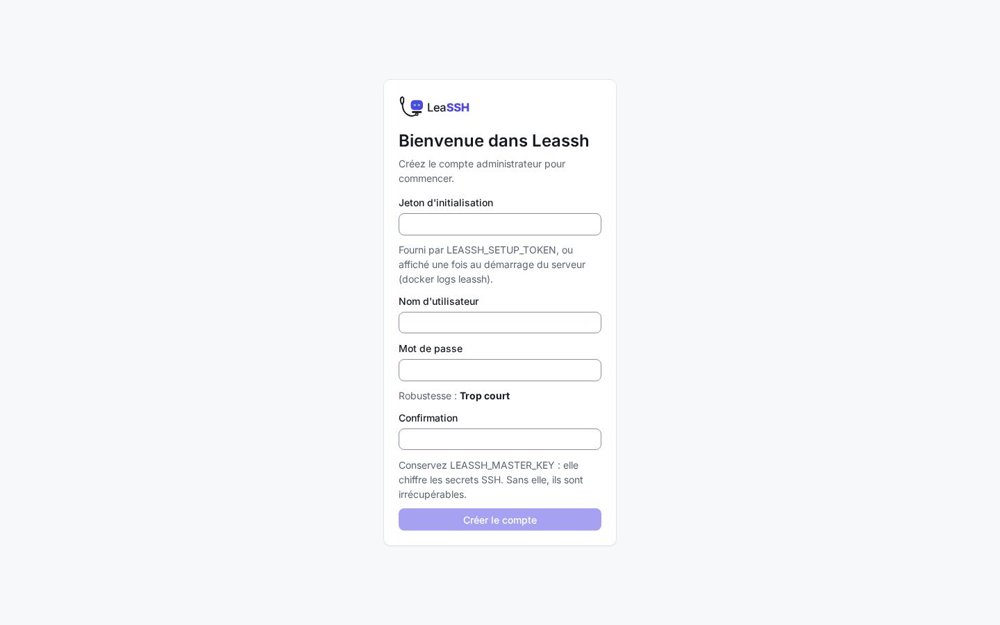

**Français** · [English](../en/getting-started.md)

# Premiers pas

Le **tableau de bord** affiche une checklist d'accueil qui se coche automatiquement. Voici le parcours complet, de l'initialisation à la première exécution.

## 1. Créer le compte administrateur

Saisissez le **jeton d'initialisation** (variable `LEASSH_SETUP_TOKEN`, ou jeton aléatoire affiché une seule fois dans les logs au premier démarrage : `docker logs leassh` ou `journalctl -u leassh`), un nom d'utilisateur et un mot de passe de 10 caractères minimum. Tant qu'aucun compte n'existe, ce jeton empêche la première personne qui atteint l'instance d'en devenir administratrice.

## 2. Créer une identité SSH

**Identités SSH → Nouvelle identité** : donnez un nom et l'utilisateur SSH, puis choisissez *Générer une clé ed25519*. Copiez la ligne de clé publique affichée.

## 3. Autoriser la clé sur les serveurs cibles

Sur chaque serveur : `echo '<clé publique>' >> ~/.ssh/authorized_keys` (utilisateur dédié recommandé, voir [Installation](installation.md) §8).

## 4. Ajouter un serveur et épingler sa clé d'hôte

**Serveurs → Ajouter un serveur** (identifiant court, nom, adresse, port, identité). Cliquez **Tester la connexion** : Leassh affiche l'empreinte de la clé d'hôte présentée. Comparez-la à l'empreinte réelle de votre serveur (`ssh-keygen -lf /etc/ssh/ssh_host_ed25519_key.pub`), puis **Faire confiance à cette clé**. Sans empreinte épinglée, le serveur reste « inconnue » et inutilisable.

## 5. Installer un pack de commandes

**Packs** → *Système Linux* → **Installer** (cochez la création du groupe de commandes) : l'aperçu liste les commandes avant l'import.

## 6. Créer un groupe de serveurs

**Serveurs → Groupes** : un groupe contenant vos serveurs (ex. « Production »).

## 7. Créer une règle d'accès

**Règles → Nouvelle règle** : groupe de serveurs + groupe de commandes + profil `RO` (lecture seule) pour commencer.

## 8. Créer une clé MCP

**Clés MCP → Nouvelle clé**, associez la règle, puis **copiez le jeton** : il n'est affiché qu'une fois.

## 9. Connecter l'agent

Collez la configuration dans votre agent (voir [Agents et outils MCP](agents-mcp.md)) et demandez-lui de lister les serveurs. La première exécution apparaît dans le **Journal**.

## 10. Vérifier avec le simulateur

Le **Simulateur d'accès** montre à tout moment, pour une clé, ce qu'elle peut faire et pourquoi. Utilisez-le avant de confier une clé à un agent.

Étapes suivantes : [créer vos propres commandes](commandes.md), [configurer le SSO](sso.md), [envoyer les journaux à votre SIEM](reglages.md), [planifier la sauvegarde](../exploitation.md).

---

[← Précédent : Installation](installation.md) · [Accueil](README.md) · [Suivant : Manuel utilisateur →](manuel-utilisateur.md)
