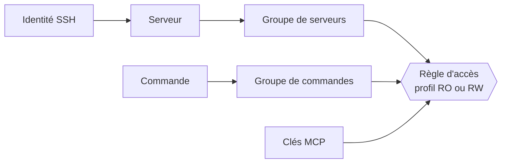

**Français** · [English](../en/overview.md)

# Présentation et concepts

## À quoi sert Leassh ?

Leassh est un serveur **MCP** (Model Context Protocol) open source qui donne à des agents d'intelligence artificielle un **accès SSH limité à un catalogue de commandes validées**. L'agent ne reçoit jamais de shell : il *choisit* une commande dans un catalogue que vous avez écrit ou approuvé, avec des paramètres typés et validés. Chaque demande — autorisée, refusée ou en attente de validation humaine — est journalisée.

Le problème résolu : filtrer les commandes d'un agent après coup (liste noire, expression régulière sur la ligne de commande) est contournable (`rm` bloqué, mais `find -delete`, `python -c`, `truncate` ou `$( )` passent). Leassh inverse la logique : **liste blanche**, paramètres typés puis échappés, droits explicites, validation humaine des actions sensibles et journal métier.

| Approche classique | Leassh |
|---|---|
| L'agent écrit une commande, on tente de la filtrer | L'agent choisit une commande dans un catalogue |
| Liste noire : tout ce qui n'est pas interdit passe | Liste blanche : rien ne passe s'il n'est pas prévu |
| Paramètres libres | Paramètres typés, validés puis échappés |
| Journaux SSH bruts | Journal métier : agent, serveur, commande, paramètres, raison, résultat, validateur |

## À qui s'adresse-t-il ?

| Rôle | Ce qu'il fait avec Leassh |
|---|---|
| **Administrateur** | Déclare les serveurs et les identités SSH, écrit ou importe les commandes, crée les règles d'accès et les clés MCP, règle l'application. |
| **Validateur** (`approver`) | Approuve ou refuse les exécutions en attente, depuis l'interface (y compris sur mobile). |
| **Lecteur** (`viewer`) | Consulte la configuration et les journaux, sans rien modifier. |
| **Agent IA** | Se connecte avec une clé MCP et ne dispose que de cinq outils. |
| **Auditeur** | Reçoit un rapport d'audit et peut vérifier l'intégrité du journal. |

## Les concepts

- **Identité SSH** : un compte SSH (utilisateur + clé privée ed25519 générée par Leassh ou importée) que Leassh utilise pour se connecter. La clé privée est chiffrée au repos.
- **Serveur** : une machine joignable en SSH (hôte, port, identité). Sa **clé d'hôte** est épinglée : toute divergence bloque le serveur.
- **Groupe de serveurs** : un ensemble de serveurs (ex. « Production »).
- **Commande** : un modèle de commande (`systemctl restart {{service}}`), des paramètres typés, un niveau de risque et une description lue par l'IA.
- **Groupe de commandes** : un ensemble de commandes, souvent créé à l'import d'un pack.
- **Règle d'accès** : relie des groupes de serveurs, des groupes de commandes et des clés MCP, avec un **profil**.
- **Clé MCP** : l'identité d'un agent. Le jeton (`lsh_…`) n'est affiché qu'une fois ; seule son empreinte est stockée.
- **Pack** : un catalogue de commandes au format YAML, importable et partageable (système, systemd, MySQL, PostgreSQL, nginx, Docker, pfSense, Proxmox, UniFi).
- **Proposition** : une commande suggérée par un agent, à relire avant toute exécution.

### Niveaux de risque et profils

| Risque | Signification | Validation humaine |
|---|---|---|
| `read` | Lecture seule (état, journaux, diagnostics) | Jamais |
| `write` | Modifie quelque chose (redémarrer un service…) | Par défaut oui (réglage de la règle) |
| `destructive` | Peut couper un service ou perdre des données | **Toujours**, quel que soit le profil |

- Profil **`RO`** : commandes `read` uniquement.
- Profil **`RW`** : `read` + `write` (validation requise par défaut pour `write`).

### Ce qui n'est jamais possible

- Pas de PTY, pas de shell interactif : uniquement des canaux SSH `exec` (ni agent forwarding, ni redirection de ports, ni X11).
- Pas de paramètre en texte libre : chaque valeur est validée selon son type puis échappée.
- Une clé MCP ne peut rien modifier : ni configuration, ni validation.
- Les secrets ne sont jamais journalisés ni renvoyés par l'API.

Voir la page [Sécurité](securite.md) pour le détail du modèle.

## Fonctionnalités

- Catalogue de commandes typées, éditeur avec aperçu, test depuis l'éditeur
- Serveurs, identités SSH, épinglage de clé d'hôte, groupes
- Clés MCP, règles d'accès, simulateur d'accès
- Validation humaine (mobile compris) et propositions de commandes
- Journal complet des exécutions et de l'administration, à chaîne d'intégrité, avec export et direct
- Packs YAML (9 fournis), webhook signé HMAC, export syslog (UDP/TCP/TLS, RFC 5424, texte/JSON/CEF)
- Provisioning des serveurs depuis un bastion Warpgate
- Rapport d'audit ISO 27001 / HDS, synthèse IA facultative
- SSO OpenID Connect (Keycloak, Entra ID, Authentik, Google…)
- Interface en français et en anglais, thèmes clair et sombre
- Un seul binaire ou une image Docker ; SQLite par défaut

---

[Accueil](README.md) · [Suivant : Installation →](installation.md)
