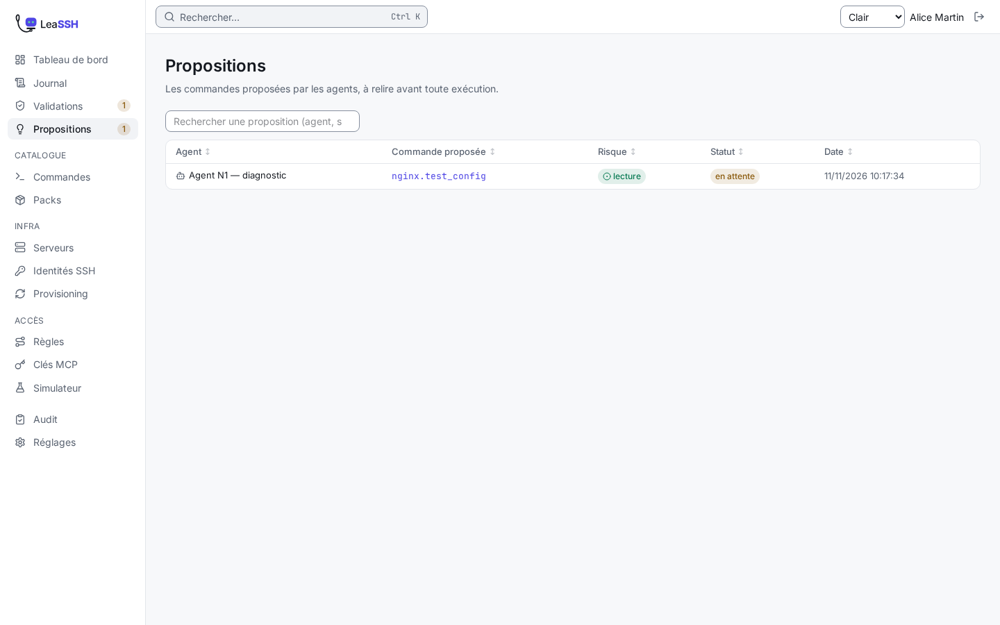
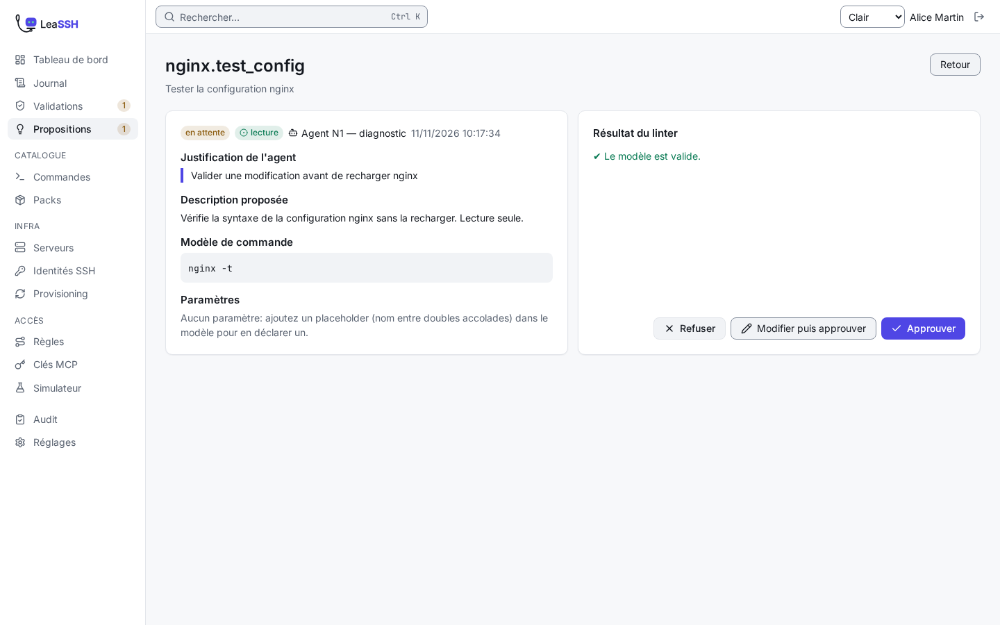

**Français** · [English](../en/proposals.md)

# Propositions

**Qui** : lecture pour tous ; approuver, modifier et rejeter : `admin`. **Chemin** : `/propositions`.

Un agent dont la clé a l'option *peut proposer* appelle l'outil `propose_command` pour suggérer une nouvelle commande (identifiant, nom, description, modèle, paramètres typés, risque, **justification**). La proposition n'est **jamais exécutable** tant qu'un administrateur ne l'a pas approuvée. Une clé ne peut avoir que 10 propositions en attente.

## La liste

Colonnes : agent, commande proposée, risque, statut (*en attente*, *invalide*, *approuvée*, *rejetée*), date. Le tri et la recherche sont disponibles.

## Le détail d'une proposition

- le **modèle** et les **paramètres** proposés ;
- le résultat du **linter** (erreurs bloquantes et avertissements) ;
- la **justification** de l'agent.

Actions : **Approuver**, **Modifier puis approuver** (ouvre l'éditeur de commande en mode proposition, avec le linter strict, le choix définitif du niveau de risque et des groupes), **Rejeter** (avec commentaire).

## Le linter

Une proposition dont le modèle contient un métacaractère shell (`;`, `&`, `|`, `` ` ``, `$(`, `>`, `<`, retour à la ligne), un placeholder non autonome ou entre guillemets, un premier mot interpréteur (`sh`, `bash`, `python`, `sudo`, `xargs`…), un type inconnu, ou un modèle réduit à un placeholder est enregistrée en **invalide** et **ne peut pas être approuvée sans correction**. Un administrateur peut écrire des commandes avec pipe (avec avertissement) ; un agent, jamais.

## À savoir

- Une commande approuvée rejoint le catalogue avec la source `proposal`. Pensez à l'ajouter à un groupe de commandes et à une règle, sans quoi aucune clé ne pourra la lancer.
- Relisez la proposition comme du code : c'est ce que l'agent pourra exécuter ensuite.

---

[← Précédent : Validations](validations.md) · [Accueil](README.md) · [Suivant : Serveurs et groupes de serveurs →](serveurs.md)
