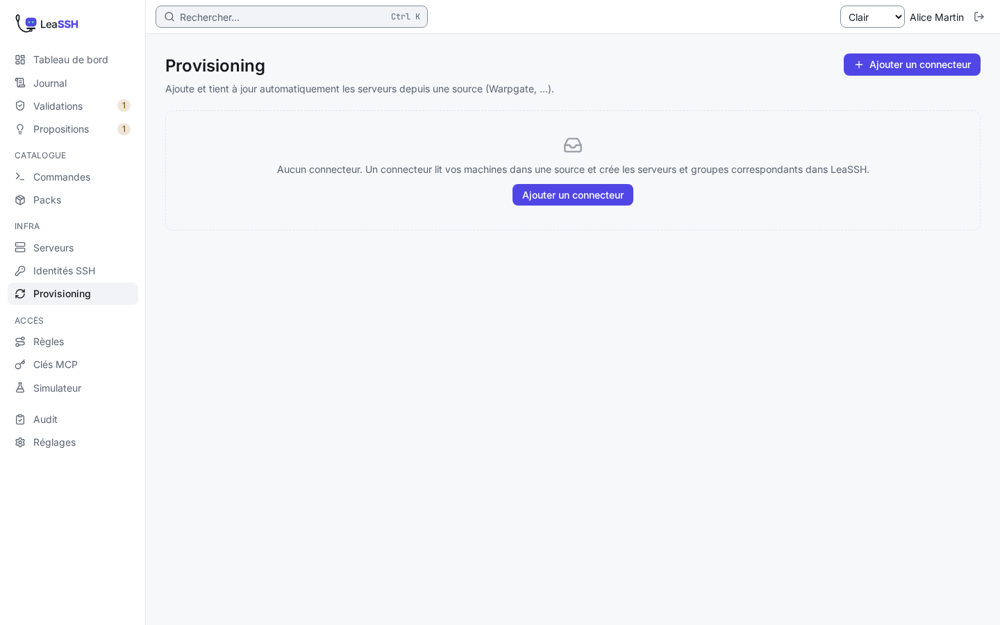

**Français** · [English](../en/provisioning.md)

# Provisioning (bastion Warpgate)

**Qui** : lecture pour tous ; gestion : `admin`. **Chemin** : `/provisioning`.

Quand vos serveurs sont déjà déclarés dans un bastion SSH (**Warpgate**), un **connecteur** les lit et crée, met à jour et désactive les serveurs et groupes de serveurs correspondants dans Leassh, au lieu de tout ressaisir.

## Mettre en place un connecteur

1. Dans Warpgate, choisissez (ou créez) un utilisateur dont le rôle donne accès aux cibles SSH voulues et générez-lui un **jeton d'API**. Il n'a pas besoin d'être administrateur.
2. Dans Leassh : **Ajouter un connecteur** — URL de Warpgate, jeton, hôte et port SSH du bastion, **identité SSH** (celle dont la clé publique est déclarée sur l'utilisateur Warpgate) et, si besoin, l'utilisateur par défaut.
3. **Tester**, comparez l'empreinte de la clé d'hôte du bastion, puis **Faire confiance à cette clé** : les machines d'un bastion partagent sa clé, elle est épinglée une fois sur le connecteur.
4. Choisissez éventuellement des **règles par défaut** : chaque *nouveau* groupe synchronisé y est ajouté une fois (accès immédiat des clés de ces règles). Sans règle, aucune machine n'est accessible tant qu'un administrateur n'en a pas créé.
5. **Aperçu** puis **Synchroniser**. L'aperçu fait exactement le même calcul que l'application puis l'annule.

Une synchronisation périodique est possible (`interval_min`, 0 = manuelle).

## Correspondance Warpgate → Leassh

| Warpgate | Leassh |
|---|---|
| Nom de la cible | Nom du serveur |
| Description | Description |
| — | `ssh_user` = `<utilisateur>:<nom exact de la cible>`, hôte et port du bastion |
| Groupes | Groupes de serveurs (une cible sans groupe est importée sans groupe) |

Seules les cibles SSH sont retenues.

## Règles de propriété

- Un serveur ou groupe synchronisé est **verrouillé** (nom, identifiant, hôte, port) et non supprimable ; identité, utilisateur SSH, étiquettes et état restent modifiables.
- Un utilisateur SSH modifié à la main n'est plus écrasé par la synchronisation (sauf si vous cochez *Suivre la synchro*).
- Un groupe synchronisé accepte des membres ajoutés à la main ; ses membres synchronisés ne peuvent pas être retirés.
- La synchronisation ne touche **jamais** aux groupes, appartenances ou règles créés par un administrateur.

## Cycle de vie et garde-fous

- Une machine disparue de la source est **désactivée** (jamais supprimée, le journal y fait référence) ; réapparue, elle est réactivée seulement si c'est la synchronisation qui l'avait désactivée.
- Une synchronisation qui désactiverait **au moins 3 machines et plus de 30 %** du parc (ou toutes si la source est vide) est **refusée** (409 `sync_blocked`) sauf confirmation (`force`).
- Une divergence de clé d'hôte (`mismatch`) n'est jamais effacée par une synchronisation ; seul un nouvel épinglage par l'administrateur la lève.
- Supprimer le connecteur conserve tout : les objets redeviennent manuels.
- Chaque synchronisation qui change quelque chose écrit un événement d'audit `provisioner.sync` (détail des changements). Le jeton d'API est chiffré et jamais renvoyé.

## À savoir

Warpgate bloque l'IP après plusieurs échecs d'authentification ; Leassh suspend 60 s les tentatives après un échec. Si les journaux Warpgate indiquent « SSH auth from blocked IP », débloquez l'IP de Leassh côté Warpgate.

---

[← Précédent : Identités SSH](identites-ssh.md) · [Accueil](README.md) · [Suivant : Commandes et groupes de commandes →](commandes.md)
