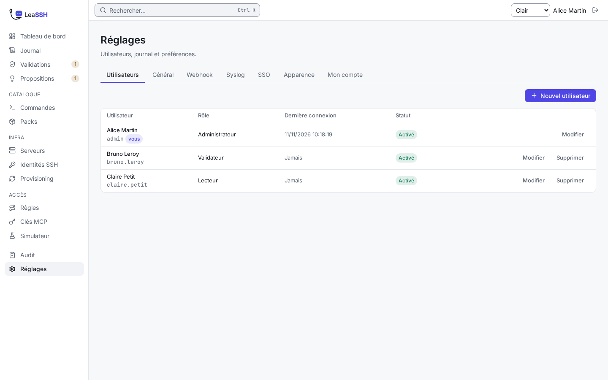
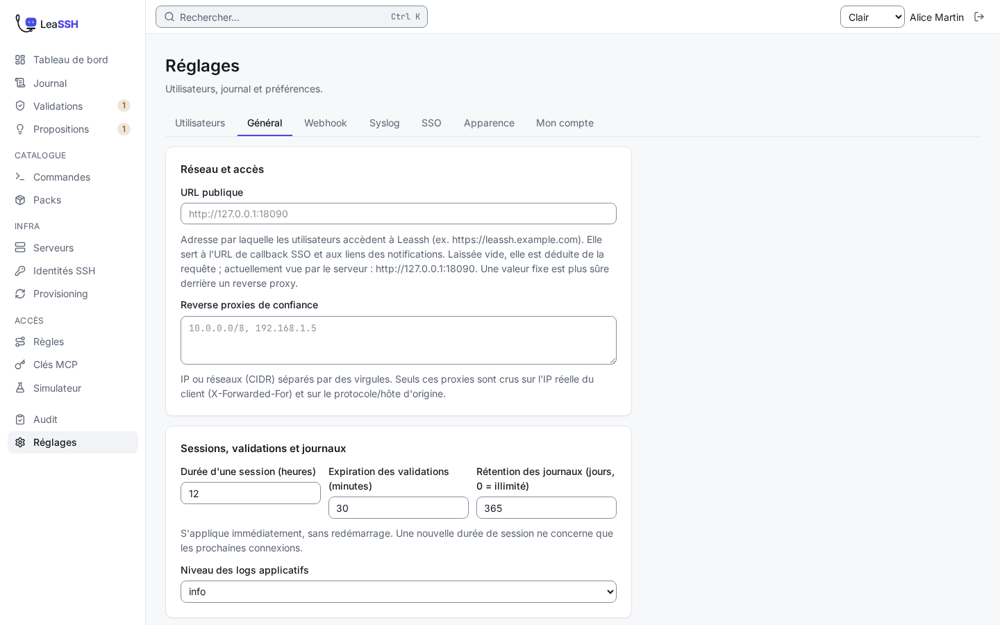
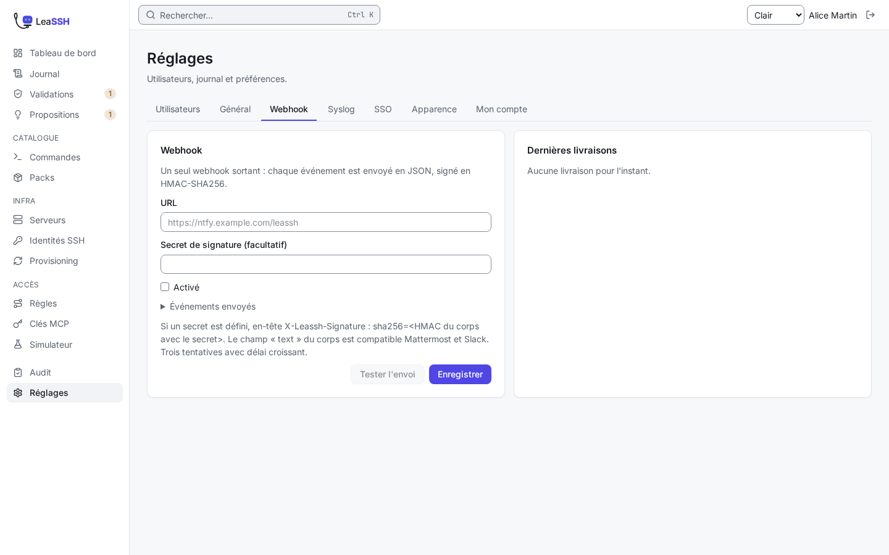
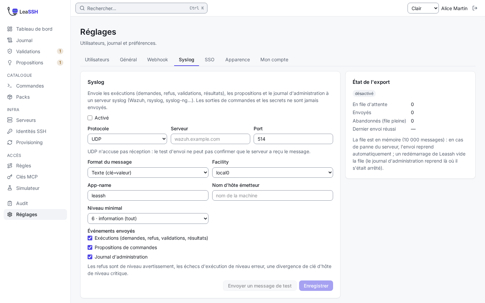
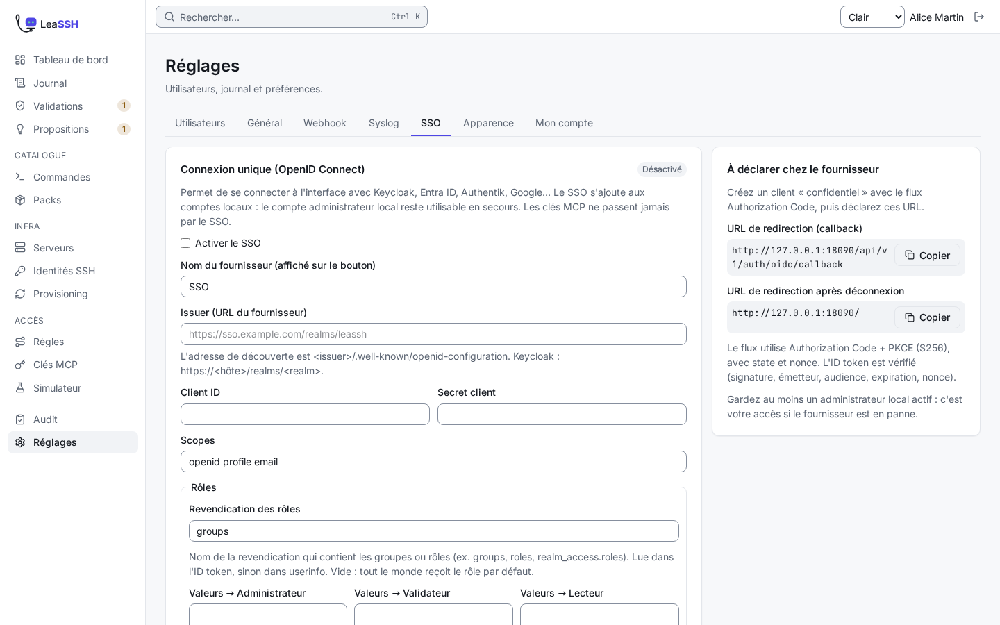
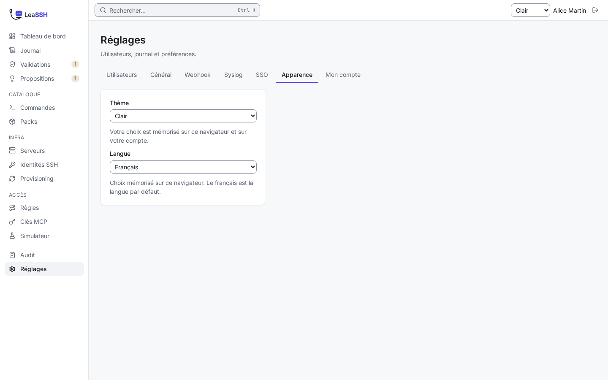
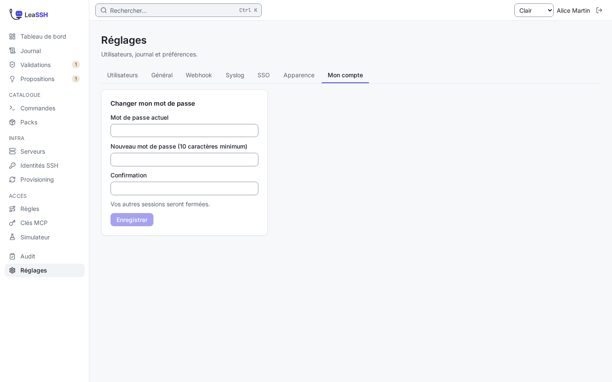

**Français** · [English](../en/settings.md)

# Réglages

**Qui** : tous voient *Apparence* et *Mon compte* ; les autres onglets sont réservés à `admin`. **Chemin** : `/reglages`.

## Utilisateurs

*Nouvel utilisateur* : identifiant, nom affiché, mot de passe (10 caractères minimum), rôle (**Administrateur**, **Validateur**, **Lecteur**). Actions : modifier, réinitialiser le mot de passe, désactiver, supprimer. Garde-fous : impossible de désactiver ou supprimer le **dernier administrateur actif** ou de s'auto-désactiver. Désactiver un compte, changer son rôle ou son mot de passe **ferme ses sessions**. Le rôle d'un compte SSO n'est pas modifiable à la main (il vient du fournisseur).

## Général

Stocké en base, appliqué à chaud, audité :

| Réglage | Rôle |
|---|---|
| **URL publique** | Adresse des utilisateurs (ex. `https://leassh.example.com`), sert à l'URL de retour SSO et aux liens des notifications. Vide : déduite de la requête. Une valeur fixe est plus sûre derrière un proxy. |
| **Reverse proxies de confiance** | IP ou réseaux CIDR crus pour `X-Forwarded-*`. Seuls ces proxies donnent l'IP réelle du client et le protocole. Si votre proxy est déclaré, il est seul responsable de HSTS. |
| **Durée d'une session** | 12 heures par défaut (30 minutes d'inactivité). |
| **Expiration des validations** | 30 minutes par défaut. |
| **Rétention des journaux** | 365 jours par défaut ; 0 = illimitée. Purge quotidienne (événement `logs.purge`), jamais des demandes en attente ou en cours. |
| **Niveau des logs applicatifs** | `info` par défaut. |
| **Jeton `/metrics`** | `/metrics` est fermé (401) tant qu'aucun jeton n'est défini ; seule l'empreinte est conservée. |

La carte **Intégrité** (même onglet) lance **Vérifier l'intégrité** : contrôle des chaînes de hash des exécutions et du journal d'administration (voir [Sécurité](securite.md)).

## Webhook

Un seul webhook sortant : URL, **secret de signature** (facultatif ; chiffré, jamais renvoyé), état, événements envoyés. Corps JSON `{text, id, event, timestamp, url, data}` (`text` est un résumé Markdown compatible **Mattermost et Slack**), en-têtes `X-Leassh-Event` et, avec un secret, `X-Leassh-Signature: sha256=<HMAC-SHA256 du corps>`.

Événements : `execution.pending_approval`, `execution.finished`, `execution.denied`, `proposal.created`, `host_key.mismatch`. Trois tentatives (1 s puis 5 s), redirections non suivies, **sorties de commandes jamais incluses**. *Tester l'envoi* ; les 200 dernières livraisons sont listées.

## Syslog

Envoi continu vers Wazuh, rsyslog, syslog-ng… des exécutions (demandes, refus, validations, résultats), des propositions et du journal d'administration (`audit.<action>`). **Jamais** de sortie de commande ni de secret.

| Option | Valeurs |
|---|---|
| Protocole | UDP, TCP, TCP + TLS (TLS ≥ 1.2, autorité propre ou système, SNI, certificat client facultatif pour mTLS) |
| Cadrage TCP/TLS | `lf` (un message par ligne, défaut) ou `octet` (RFC 6587) |
| Format | RFC 5424 avec message **texte** (`clé=valeur`), **JSON** (Wazuh) ou **CEF** |
| Facility, app-name, nom d'hôte | configurables (défaut `local0`, `leassh`) |
| Niveau minimal et types | `execution`, `proposal`, `audit` |

Gravité : refus = `warning` ; en attente, expirée, rejetée, proposition = `notice` ; échec ou délai dépassé = `warning` ; erreur interne = `err` ; `host_key.mismatch` = `crit` ; le reste = `info`. Une file en mémoire de 10 000 messages et une reconnexion automatique (1 s à 60 s) évitent de bloquer Leassh ; les événements d'administration sont rattrapés après un redémarrage (au moins une fois). *Envoyer un message de test* vérifie la configuration (UDP ne peut pas confirmer la réception). Exemple Wazuh : voir [Exploitation](../exploitation.md).

## SSO

Connexion OpenID Connect. Le guide pas à pas (Keycloak, Entra ID, Authentik, Google) est dans la page [SSO](sso.md).

## Apparence

**Thème** (Système, Clair, Sombre), mémorisé sur le navigateur et sur le compte. **Langue** (Français, English), mémorisée dans le navigateur ; le français est la langue par défaut. Les messages d'erreur de l'API suivent la langue de l'interface.

## Mon compte

Changer son mot de passe (comptes locaux seulement ; les autres sessions sont fermées). Un compte SSO n'a pas de mot de passe local.

---

[← Précédent : Rapport d'audit (ISO 27001, HDS)](audit.md) · [Accueil](README.md) · [Suivant : Agents et outils MCP →](agents-mcp.md)
