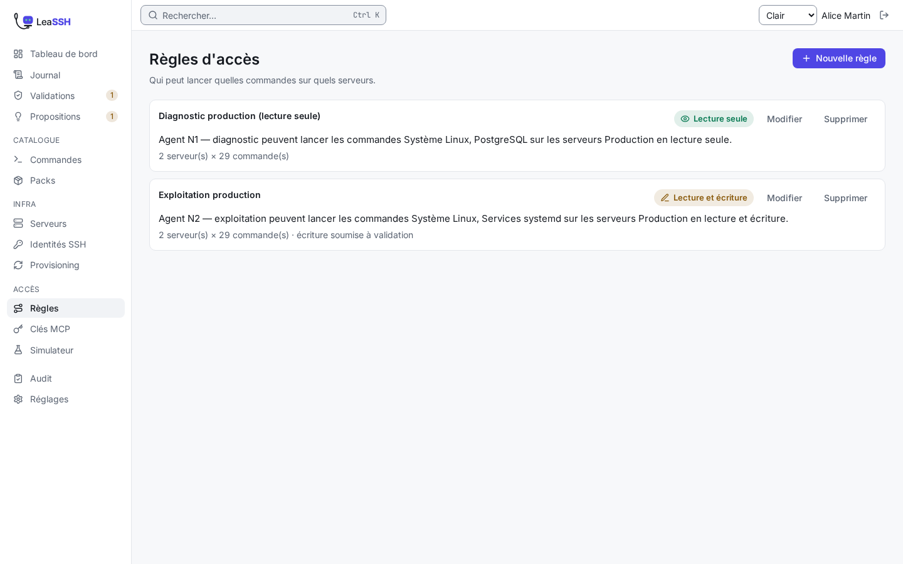
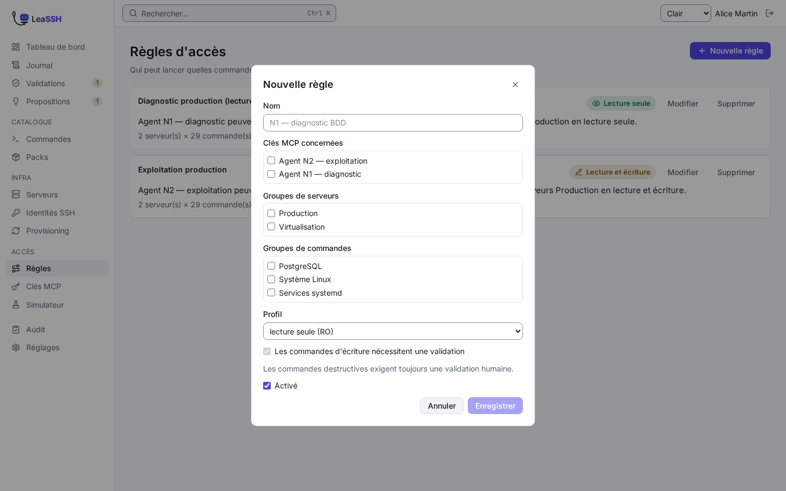
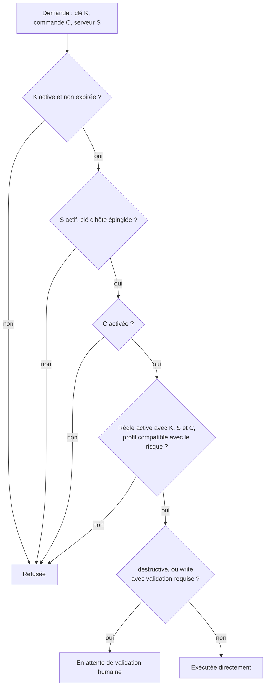

**Français** · [English](../en/access-rules.md)

# Règles d'accès

**Qui** : lecture pour tous ; gestion : `admin`. **Chemin** : `/regles`.

Une **règle d'accès** dit *qui peut lancer quelles commandes sur quels serveurs*. C'est le seul endroit où des droits sont accordés.

## Anatomie d'une règle

- **Nom** ;
- un **ensemble de groupes de serveurs** et un **ensemble de groupes de commandes** (au moins un de chaque) : les serveurs et commandes couverts sont l'**union** des groupes ;
- un **profil** : `RO` (commandes `read` seulement) ou `RW` (`read` + `write` + `destructive`) ;
- **La validation des écritures** (`write_requires_approval`, vrai par défaut) ;
- les **clés MCP** concernées ;
- un état actif.

La carte d'une règle résume en une phrase : « *Agent N2 — exploitation* peuvent lancer les commandes *Système Linux, Services systemd* sur les serveurs *Production* en lecture et écriture », avec le nombre de serveurs × commandes couverts et la mention « écriture soumise à validation ».

## L'évaluation des droits

Une clé `K` peut exécuter la commande `C` sur le serveur `S` si et seulement si :

1. `K` est active et non expirée ;
2. `S` est actif et sa clé d'hôte est **épinglée** ;
3. `C` est activée ;
4. il existe une règle active contenant `K`, dont un groupe de serveurs contient `S` et un groupe de commandes contient `C`, avec un profil compatible avec le risque de `C`.

La **validation humaine** est requise si `C` est `destructive` (toujours), ou `write` avec `write_requires_approval` vrai. Si plusieurs règles autorisent la même combinaison, la **moins contraignante** s'applique et son identifiant est journalisé.

## Gestes courants

- Commencer par une règle `RO` sur un groupe de serveurs limité, vérifier avec le [Simulateur](simulateur.md), puis élargir.
- Séparer les agents : une règle de diagnostic (RO) et une règle d'exploitation (RW) avec des clés différentes.

## À savoir

- Modifier ou supprimer une règle prend effet immédiatement, y compris sur une validation déjà en attente (revérifiée à l'exécution).
- Toute modification est dans le journal d'administration, avec son diff.

---

[← Précédent : Packs de commandes](packs.md) · [Accueil](README.md) · [Suivant : Clés MCP →](cles-mcp.md)
