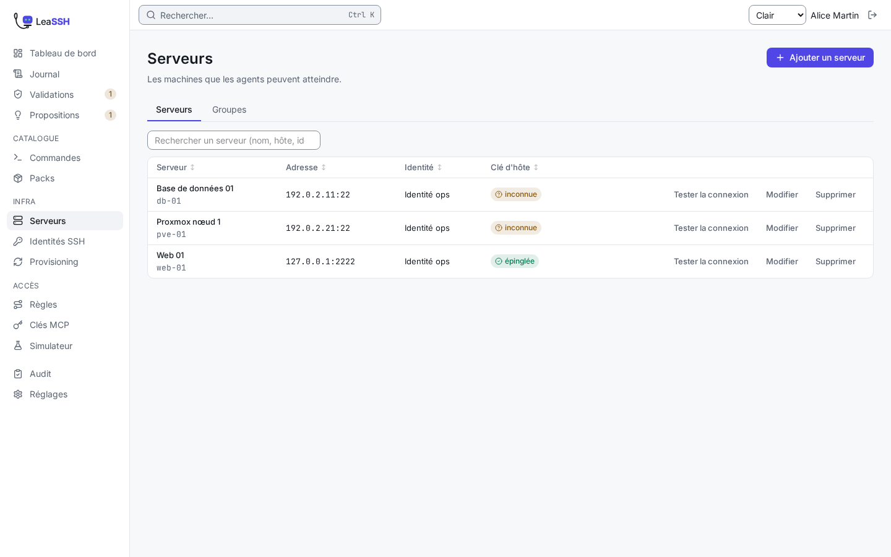
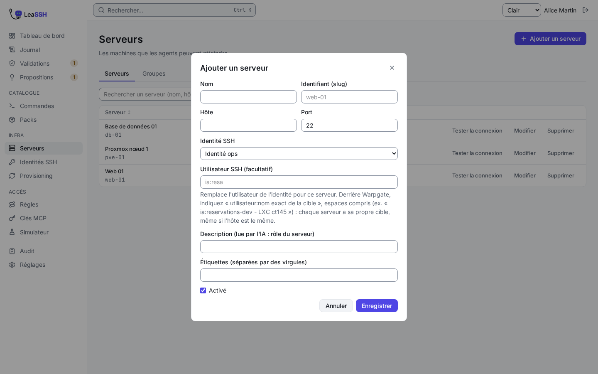

**Français** · [English](../en/servers.md)

# Serveurs et groupes de serveurs

**Qui** : lecture pour tous ; création, modification, suppression : `admin`. **Chemin** : `/serveurs` (onglets *Serveurs* et *Groupes*).

## Colonnes

Serveur (nom et identifiant court), adresse (hôte:port), identité SSH, **clé d'hôte** et actions *Tester la connexion*, *Modifier*, *Supprimer*. Le tri et la recherche sont disponibles.

### États de la clé d'hôte

| État | Signification | Conséquence |
|---|---|---|
| **inconnue** | Aucune empreinte épinglée | Le serveur est **inutilisable** |
| **épinglée** | L'empreinte validée correspond | Utilisable |
| **divergente** (`mismatch`) | Le serveur présente une autre clé | **Serveur bloqué**, événement d'audit, webhook `host_key.mismatch` |

## Ajouter un serveur

Champs : identifiant court (*slug*, stable, utilisé par les agents), nom, adresse, port, identité SSH, description, **utilisateur SSH** (facultatif : remplace celui de l'identité, utile derrière un bastion), étiquettes, état actif.

## Épingler la clé d'hôte

1. **Tester la connexion** : Leassh se connecte et affiche l'**empreinte** présentée (`SHA256:…`) et le type de clé.
2. **Comparez-la** avec l'empreinte réelle du serveur : `ssh-keygen -lf /etc/ssh/ssh_host_ed25519_key.pub`.
3. **Faire confiance à cette clé** : l'épinglage exige que l'empreinte confirmée soit toujours celle présentée à cet instant.

Si la clé change plus tard (réinstallation, attaque), le serveur passe en **divergente** et est bloqué : vérifiez l'empreinte avant de choisir *Accepter la nouvelle clé*.

## Groupes de serveurs

L'onglet **Groupes** crée des ensembles (« Production », « Virtualisation »…) utilisés par les [règles d'accès](regles-d-acces.md). Un serveur peut appartenir à plusieurs groupes.

## Serveurs synchronisés

Un serveur créé par un [connecteur de provisioning](provisioning.md) porte l'icône ↻ : nom, identifiant, hôte, port et description sont verrouillés (409 `managed`) et il n'est pas supprimable ; identité, utilisateur SSH, étiquettes et état restent modifiables.

## À savoir

- Après un échec d'authentification, Leassh suspend 60 s les tentatives sur ce serveur (statut `ssh_cooldown` dans le journal) pour ne pas déclencher un blocage d'IP par un bastion ou fail2ban. Toute modification du serveur lève la pause.
- Supprimer un serveur n'efface pas le journal qui le cite.

---

[← Précédent : Propositions](propositions.md) · [Accueil](README.md) · [Suivant : Identités SSH →](identites-ssh.md)
