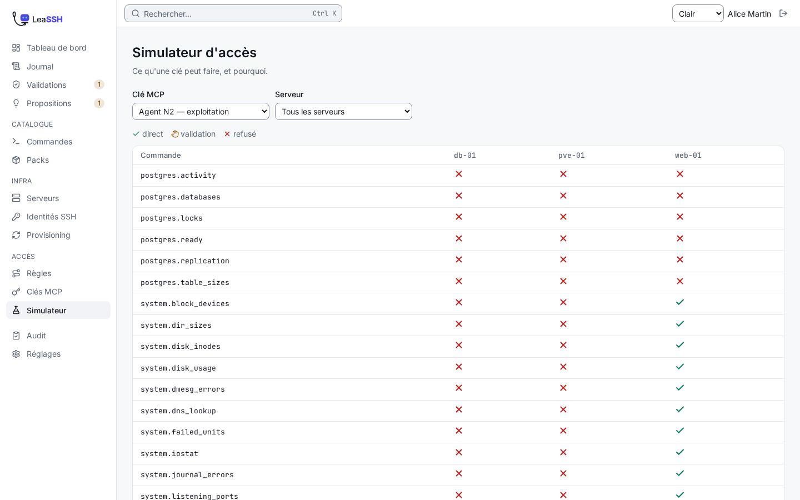

**Français** · [English](../en/simulator.md)

# Simulateur d'accès

**Qui** : tous les rôles. **Chemin** : `/simulateur`.

Le simulateur répond à : *« que peut faire cette clé, et pourquoi ? »*. Il utilise **exactement la même fonction d'évaluation** que l'exécution réelle (voir [Règles d'accès](regles-d-acces.md)).

## Utilisation

1. Choisissez une **clé MCP**.
2. Choisissez un **serveur**, ou *Tous les serveurs*.
3. Le tableau croise les commandes (lignes) et les serveurs (colonnes) :

| Symbole | Signification |
|---|---|
| ✓ **direct** | La commande s'exécute sans validation |
| ✋ **validation** | Exécutable après validation humaine |
| ✗ **refusé** | Non autorisé |

Pour chaque cellule autorisée, la **règle** qui la permet est indiquée.

## Quand l'utiliser ?

- **Avant** de confier une clé à un agent : vérifiez qu'elle ne couvre que ce que vous voulez.
- **Pour comprendre un refus** : si un agent reçoit « serveur ou commande indisponible pour cette clé » (message volontairement générique), le simulateur et le [Journal](journal.md) donnent la raison exacte.
- **Après** une modification de règle, de groupe ou de clé d'hôte.

## À savoir

- Un serveur dont la clé d'hôte n'est pas épinglée apparaît en refus pour toutes les commandes.
- Une clé expirée ou révoquée est refusée partout.

---

[← Précédent : Clés MCP](cles-mcp.md) · [Accueil](README.md) · [Suivant : Rapport d'audit (ISO 27001, HDS) →](audit.md)
