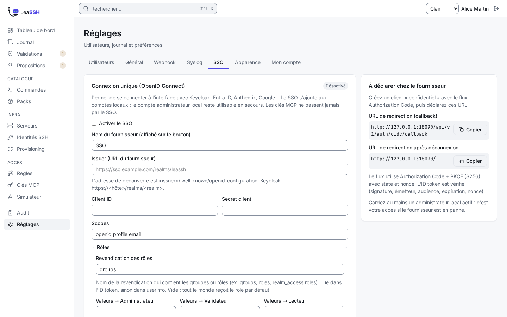
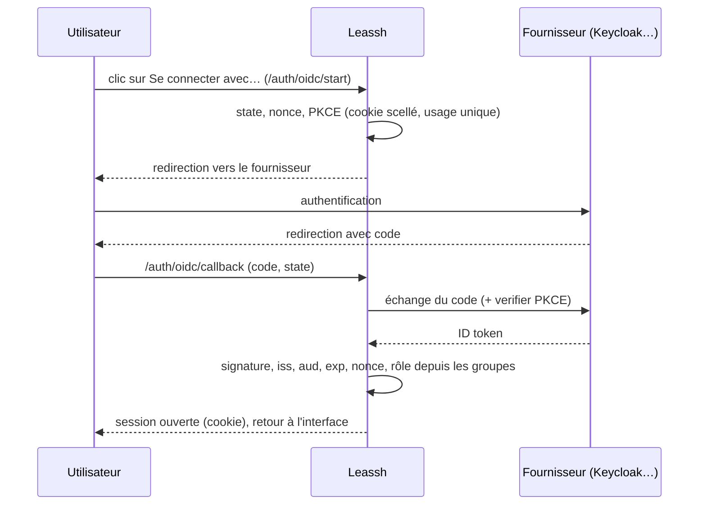

**Français** · [English](../en/sso.md)

# Connexion unique (SSO, OpenID Connect)

**Fonctionnement.** Authorization Code + **PKCE S256**, `state` et `nonce`. Leassh vérifie l'ID token (signature par le JWKS du fournisseur, `iss`, `aud`, `exp`, `nonce`), calcule le rôle à partir d'une revendication de groupes, puis ouvre la session habituelle. Les comptes sont liés à `(issuer, sub)`, **jamais à l'e-mail**. Un seul fournisseur ; pas de SCIM. Voir l'[ADR 0001](../adr/0001-authentification-sso-et-compte-local.md).

Le SSO permet de se connecter à l'**interface** avec Keycloak (ou Entra ID, Authentik, Google…). Le compte administrateur créé à l'initialisation sert à la première connexion et à configurer le SSO ; une fois le SSO validé, vous pouvez désactiver le mot de passe local (étape 8, [ADR 0001](../adr/0001-authentification-sso-et-compte-local.md)). Les clés MCP ne passent pas par le SSO.

**Avant de commencer** : Leassh doit être joignable par l'URL que vos utilisateurs saisissent (Réglages → Général → URL publique, par ex. `https://leassh.example.com`, ou à défaut l'adresse utilisée dans le navigateur). Le serveur Leassh doit pouvoir joindre Keycloak (découverte, jetons, JWKS) et l'horloge des deux machines doit être à l'heure (NTP; tolérance de 60 s).

## Côté Keycloak

1. Choisissez le realm (ou créez-en un, par ex. `leassh`). L'**issuer** sera `https://<hôte-keycloak>/realms/leassh` (Keycloak ≥ 17; avant : `/auth/realms/leassh`).
2. **Clients → Create client** : *Client type* `OpenID Connect`, *Client ID* `leassh`.
3. *Capability config* : **Client authentication = On** (client confidentiel), *Standard flow* coché, le reste décoché.
4. *Login settings* — saisissez les deux URL affichées dans **Réglages → SSO** (colonne de droite, bouton Copier) :
   - *Valid redirect URIs* : `https://leassh.example.com/api/v1/auth/oidc/callback` (exactement);
   - *Valid post logout redirect URIs* : `https://leassh.example.com/` ;
   - *Web origins* peut rester vide.
5. Onglet **Advanced → Advanced settings** : *Proof Key for Code Exchange Code Challenge Method* = `S256`.
6. Onglet **Credentials** : copiez le *Client secret*.
7. **Groupes** : créez par ex. `leassh-admins`, `leassh-approvers`, `leassh-readers` (Groups) et placez-y vos utilisateurs.
8. **Mapper des groupes** : *Clients → leassh → Client scopes → leassh-dedicated → Add mapper → By configuration → Group Membership* : *Name* `groups`, *Token Claim Name* `groups`, **Full group path = On** (valeurs `/leassh-admins`) ou Off (valeurs `leassh-admins`), *Add to ID token = On*, *Add to userinfo = On*. (Pour utiliser les rôles du realm à la place, la revendication est `realm_access.roles`, ajoutée à l'access token par défaut : activez-la aussi dans l'ID token ou le userinfo via un mapper *User Realm Role*.)

## Côté Leassh (Réglages → SSO)

1. *Nom du fournisseur* : `Keycloak` (texte du bouton « Se connecter avec Keycloak »).
2. *Issuer* : `https://<hôte-keycloak>/realms/leassh`, puis **Tester la découverte** : vous devez voir les endpoints, le nombre de clés de signature et d'éventuels avertissements (issuer en HTTP, pas de déconnexion fournisseur…).
3. *Client ID* `leassh`, *Secret client* (collez celui de l'étape 6; il est chiffré et plus jamais affiché). *Scopes* : `openid profile email` (ajoutez `groups` ou `roles` si votre fournisseur l'exige).
4. *Rôles* : *Revendication* `groups`; une valeur par ligne dans chaque colonne, par ex. `/leassh-admins` → Administrateur, `/leassh-approvers` → Validateur, `/leassh-readers` → Lecteur. Le rôle le plus élevé gagne. *Sans correspondance* : « Lecteur » ou « Refuser la connexion » (recommandé en production).
5. *Comptes* : laissez « créer automatiquement le compte » pour que chaque nouvelle personne autorisée obtienne un compte à sa première connexion. Les comptes sont liés à l'identifiant `sub` du fournisseur, **jamais à l'e-mail ni au nom** : un compte local portant le même nom n'est pas repris, le compte SSO reçoit un nom suffixé.
6. *Réserver le mot de passe local aux administrateurs locaux* : à cocher une fois le SSO validé (les admins locaux gardent le secours). *Fermer aussi la session chez le fournisseur* : utilise l'URL de déconnexion de l'étape 4.
7. Cochez **Activer le SSO**, enregistrez, puis testez dans une fenêtre privée en gardant votre session admin ouverte. Chaque connexion et chaque échec sont dans le journal d'administration (`user.sso_login`, `user.sso_login_failed` avec le motif).
8. *Désactiver le mot de passe local (SSO obligatoire)* : une fois qu'un administrateur SSO s'est connecté avec succès, cochez cette option et enregistrez. Plus aucun compte local ne peut se connecter par mot de passe, administrateur compris. Si le SSO tombe, réactivez le local sur le serveur : `LEASSH_DATA_DIR=/data leassh enable-local-login` (Docker : `docker exec leassh /leassh enable-local-login`).

## Autres fournisseurs

| Fournisseur | Issuer | Notes |
|---|---|---|
| Entra ID | `https://login.microsoftonline.com/<tenant>/v2.0` | Enregistrement d'application, secret client, redirection *Web*; revendication `groups` (ID de groupes) via *Token configuration* ou `roles` via *App roles*. |
| Authentik | `https://<hôte>/application/o/<slug>/` | Fournisseur OAuth2/OpenID, scope `groups` (ajouté au mapping *profile*). |
| Google | `https://accounts.google.com` | Pas de groupes : laissez la revendication vide et utilisez le rôle par défaut (ou refusez), le rôle admin se gère ensuite par le secours local. |

## Problèmes courants

| Symptôme (`?sso_error=`) | Cause probable |
|---|---|
| `discovery_failed` | Issuer erroné (slash final, `/auth` en trop), Keycloak injoignable depuis Leassh, ou l'`issuer` annoncé diffère (mauvais nom d'hôte / `KC_HOSTNAME`). |
| `token_exchange_failed` | Secret client faux, URL de redirection non déclarée à l'identique, PKCE non accepté. |
| `token_expired` / `token_not_yet_valid` | Horloges désynchronisées. |
| `token_audience` | Le client ID ne correspond pas (ou mapper d'audience manquant). |
| `role_not_mapped` | La revendication est absente du jeton (mapper non ajouté à l'ID token / userinfo) ou aucune valeur ne correspond (chemin complet `/groupe` ou non). |
| `state_missing` | Cookie perdu : retour par un autre navigateur ou une autre adresse que celle du départ, ou lien déjà utilisé. Utilisez toujours la même URL. |

Un issuer en `http://` fonctionne (réseau local) mais le code d'autorisation et le secret circulent en clair : préférez HTTPS.

## Audit

Chaque connexion et chaque échec sont dans le [journal d'administration](journal.md) : `user.sso_login`, `user.sso_login_failed` (avec le motif : `state_mismatch`, `token_signature`, `token_audience`, `role_not_mapped`, `not_provisioned`, `account_disabled`…, jamais de jeton), `user.create`, `user.update`, `oidc.update`, `oidc.test`.

## Limites

Un seul fournisseur ; pas de SCIM ni de déprovisionnement automatique (un utilisateur retiré du fournisseur ne peut plus se connecter mais garde sa session jusqu'à expiration : désactivez son compte pour un effet immédiat) ; pas de back-channel logout ; avec la création automatique désactivée, seuls les comptes déjà liés se connectent.

---

[← Précédent : Modèle de sécurité](securite.md) · [Accueil](README.md) · [Suivant : Exploitation : mise à jour, sauvegarde, supervision →](../exploitation.md)
