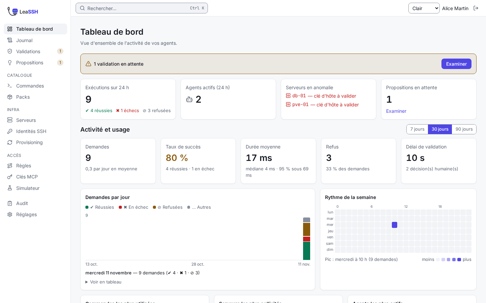

**Français** · [English](../en/dashboard.md)

# Tableau de bord

**Qui** : tous les rôles (lecture). **Chemin** : `/`.

## Ce que l'écran affiche

- **Checklist d'accueil** (instance neuve) : six étapes cochées automatiquement (identité, serveur à clé épinglée, commandes, règle, clé MCP, agent connecté). « Agent connecté » signifie qu'une clé MCP a déjà servi.
- **Bandeau d'alerte** : nombre de validations en attente, avec le bouton *Examiner* qui mène aux [Validations](validations.md).
- **Quatre tuiles** : exécutions sur 24 h (réussies, échecs, refusées), agents actifs sur 24 h, **serveurs en anomalie** (clé d'hôte à valider ou divergente, connexion en échec), propositions en attente.
- **Activité et usage** (bascule 7 / 30 / 90 jours) : demandes, taux de succès, durée moyenne (médiane, 95e centile), refus, délai moyen de validation humaine ; barres empilées par jour (réussies, échecs, refusées, autres) avec tableau équivalent (*Voir en tableau*) ; carte de chaleur semaine × heure ; classements des commandes, serveurs et agents les plus actifs ; commandes les plus lentes ; principales causes de refus.

Les couleurs sont toujours doublées d'une icône ou d'un texte (accessibilité).

## Gestes courants

- Cliquer *Examiner* pour traiter une validation en attente.
- Cliquer un serveur en anomalie pour aller le corriger (typiquement : tester la connexion et épingler la clé d'hôte).
- Changer la période pour comparer 7, 30 ou 90 jours.

## À savoir

- Les heures de la carte de chaleur sont regroupées dans le fuseau de votre navigateur.
- Un taux de succès faible n'est pas toujours un problème : les commandes refusées comptent parmi les « demandes ».

---

[← Précédent : Connexion et initialisation](connexion.md) · [Accueil](README.md) · [Suivant : Journal →](journal.md)
