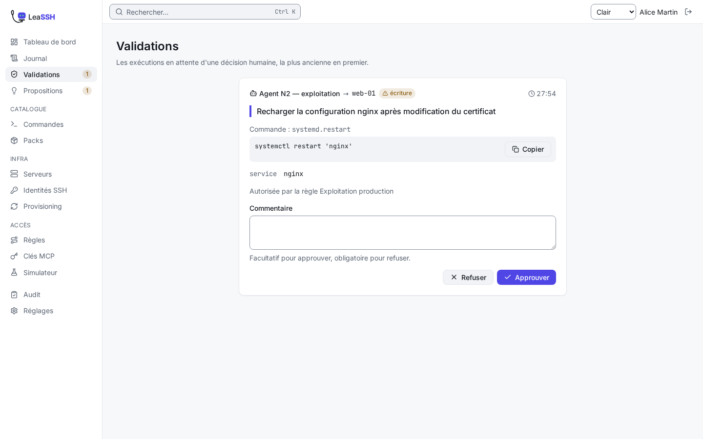
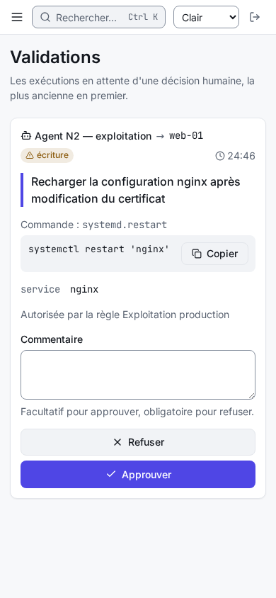

**Français** · [English](../en/approvals.md)

# Validations

**Qui** : `admin` et `approver` (les lecteurs ne voient pas les boutons). **Chemin** : `/validations`.

## Quand une validation est-elle demandée ?

- Une commande `destructive` : **toujours**, quel que soit le profil de la règle.
- Une commande `write` : si la règle exige la validation des écritures (réglage par défaut).

L'agent reçoit `pending_approval` et suit l'état avec `get_execution(wait_seconds)` : il attend votre décision.

## Une carte par demande (plus ancienne d'abord)

- **Qui et où** : l'agent (clé MCP) → serveur, avec le badge de risque ;
- **Compte à rebours** avant expiration (30 minutes par défaut, réglable dans [Réglages → Général](reglages.md)) : passé ce délai, la demande devient `expired` et rien ne s'exécute ;
- **Le motif** donné par l'agent ;
- **La commande** (identifiant) et la **ligne exacte rendue**, avec bouton *Copier* ;
- **Les paramètres** validés ;
- **La règle** qui autorise la demande ;
- un champ **Commentaire** : facultatif pour approuver, **obligatoire pour refuser** ;
- les boutons **Refuser** et **Approuver**.

## Que se passe-t-il à l'approbation ?

Leassh **revérifie** juste avant d'exécuter : clé toujours active, règle toujours valide, empreinte du modèle identique. Si l'un de ces points a changé depuis la demande, l'exécution passe en `error` avec la raison, sans rien lancer. La décision est enregistrée de façon atomique avec son événement d'audit (qui, quand, commentaire).

## Sur mobile

Un webhook (Mattermost, Slack…) peut vous prévenir dès qu'une validation est en attente (voir [Réglages → Webhook](reglages.md)).

## À savoir

- Lisez la **ligne rendue** : c'est ce qui sera réellement envoyé.
- Un refus avec commentaire est visible dans le [Journal](journal.md) et par l'agent.

---

[← Précédent : Journal](journal.md) · [Accueil](README.md) · [Suivant : Propositions →](propositions.md)
